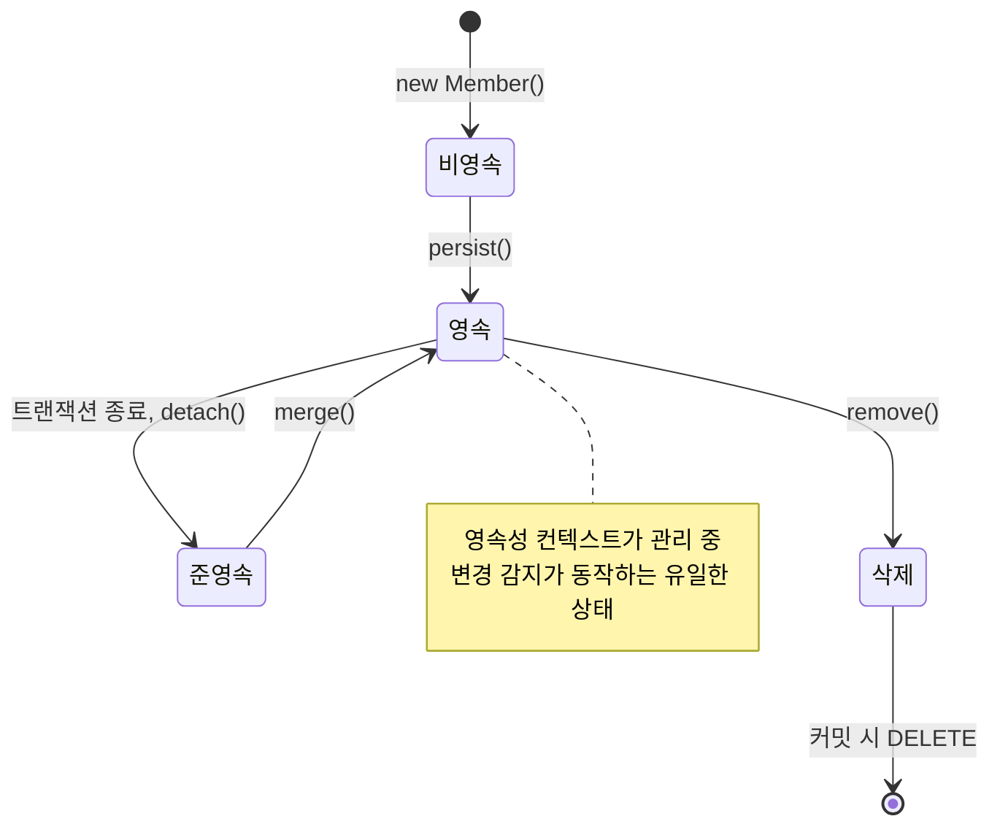
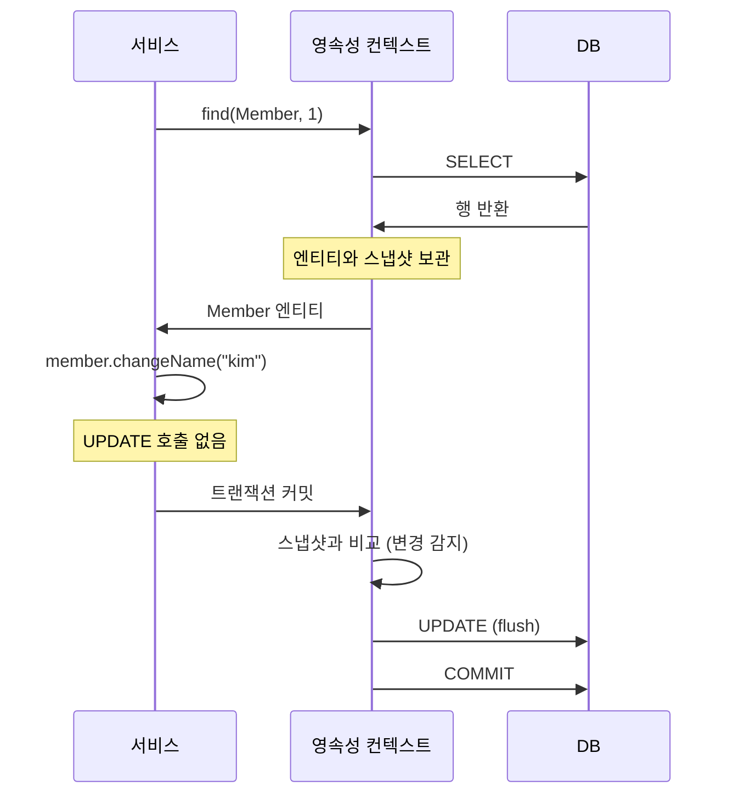

# JPA와 Hibernate 딥다이브

> 탄생 배경 → 핵심 원리 → 사용법 → 진화 과정 → 응용과 실무 → 대안과 트레이드오프 순서로 정리한 학습 노트.
> 그림은 Mermaid로 작성했다. 버전 정보 확인 시점: 2026-11-14

---

## 1. 탄생 배경 — 왜 생겼는가

### 내가 이 주제를 파게 된 이유

> (직접 채워 넣기: 어떤 상황에서 JPA를 쓰게 됐고, 무엇이 궁금했는지)

### 이전에는 어떻게 했나: JDBC로 직접 SQL

```java
public Member findById(Long id) throws SQLException {
    String sql = "SELECT id, name, team_id FROM member WHERE id = ?";
    try (Connection con = dataSource.getConnection();
         PreparedStatement ps = con.prepareStatement(sql)) {
        ps.setLong(1, id);
        try (ResultSet rs = ps.executeQuery()) {
            if (!rs.next()) return null;
            Member m = new Member();
            m.setId(rs.getLong("id"));
            m.setName(rs.getString("name"));
            m.setTeamId(rs.getLong("team_id"));   // 컬럼 하나 추가되면 여기도, INSERT도, UPDATE도 수정
            return m;
        }
    }
}
```

### 구체적인 고통

- **반복 코드.** 테이블마다 INSERT, SELECT, UPDATE, DELETE와 객체 변환 코드를 손으로 썼다. 컬럼 하나를 추가하면 관련된 SQL과 매핑 코드를 전부 고쳐야 했다.
- **패러다임 불일치 (object-relational impedance mismatch).** 객체와 테이블은 세상을 다르게 본다.

| | 객체 | 관계형 DB |
|---|---|---|
| 연관 | 참조로 따라간다 (`member.getTeam()`) | 외래 키로 JOIN한다 |
| 상속 | 있다 | 없다 |
| 동일성 | `==`로 같은 인스턴스인지 비교 | 기본 키로 같은 행인지 비교 |
| 탐색 | 그래프를 자유롭게 따라간다 | 실행한 SQL이 가져온 범위까지만 |

- **객체답게 설계할수록 SQL 작업이 늘어난다.** 그래서 결국 객체를 테이블 모양 그대로 만들게 되고, 객체지향의 이점을 잃었다.
- **당시의 표준(EJB 2 엔티티 빈)은 너무 무거웠다.** 구현해야 할 인터페이스가 많고 컨테이너 없이는 테스트조차 어려웠다.

SQL 매퍼(iBATIS, 지금의 MyBatis)가 반복 코드는 줄여 줬지만, SQL을 직접 쓰는 한 패러다임 불일치는 남았다.

### 누가, 언제 만들었나

| 시점 | 사건 |
|---|---|
| 2001년 5월 23일 | Gavin King이 Hibernate 첫 버전 공개. EJB 2 엔티티 빈의 대안으로 시작 |
| 2006년 5월 11일 | JPA 1.0 명세 확정 (JSR 220). Gavin King도 전문가 그룹에 참여했고, Hibernate·TopLink 등의 아이디어가 표준에 반영됨 |
| 2006년 이후 | Hibernate 3.2부터 JPA 구현체가 됨 |

정리하면 **JPA는 명세(인터페이스), Hibernate는 그 구현체**다. 순서는 Hibernate가 먼저였고, 표준이 그것을 따라갔다.

### 핵심 아이디어 한 줄

객체를 자바 컬렉션에 넣고 빼듯이 다루면, SQL은 프레임워크가 대신 만든다.

---

## 2. 핵심 원리 — 어떻게 동작하는가

### ① 엔티티 매핑: 클래스와 테이블을 잇는다

`@Entity`, `@Id`, `@ManyToOne` 같은 어노테이션으로 "이 클래스는 이 테이블, 이 필드는 이 컬럼, 이 참조는 이 외래 키"라고 알려준다.

### ② 영속성 컨텍스트 (persistence context): 엔티티를 보관하는 작업 공간

JPA를 이해하는 데 가장 중요한 개념이다. 트랜잭션 동안 엔티티를 담아 두는 메모리 공간이다.

- **1차 캐시.** 같은 트랜잭션에서 같은 ID를 두 번 조회하면 SQL은 한 번만 나간다.
- **동일성 보장.** 같은 ID로 조회한 두 객체는 `==`가 true다. 패러다임 불일치의 "동일성" 문제를 여기서 푼다.



### ③ 변경 감지 (dirty checking)와 쓰기 지연 (write-behind)

`update()` 메서드가 없다. 영속 상태의 엔티티 값을 바꾸기만 하면, 커밋 직전에 JPA가 처음 상태(스냅샷)와 비교해서 UPDATE를 만든다. SQL은 모아 두었다가 플러시(flush) 시점에 한꺼번에 보낸다.



### ④ 지연 로딩 (lazy loading)과 프록시

`member.getTeam()`을 호출하기 전까지 Team을 조회하지 않는다. JPA가 Team 자리에 가짜 객체(프록시)를 넣어 두고, 실제로 값을 쓸 때 SELECT를 보낸다. 패러다임 불일치의 "탐색" 문제를 푸는 방법이지만, **N+1 문제의 원인**이기도 하다.

### ⑤ JPQL: 테이블이 아니라 엔티티를 대상으로 하는 쿼리

`SELECT m FROM Member m WHERE m.name = :name`. 테이블 이름이 아니라 클래스 이름을 쓴다. JPA가 DB 종류에 맞는 SQL로 바꾼다.

### 비유와 그 한계

영속성 컨텍스트는 도서관 사서의 책상과 같다. 책(엔티티)을 서고(DB)에서 꺼내 책상에 올려 두고, 같은 책을 또 달라고 하면 책상에서 바로 준다. 퇴근할 때(커밋) 책상 위 책의 변경 사항을 서고에 반영한다.

어긋나는 지점: 책상은 **트랜잭션마다 새로 생기고 끝나면 사라진다.** 그리고 책상을 거치지 않고 서고를 직접 고치면(벌크 UPDATE, 네이티브 SQL) 책상 위의 책은 옛 내용 그대로 남는다.

---

## 3. 사용법 — 어떻게 쓰는가

Spring Boot + Spring Data JPA 기준.

### 의존성과 설정

```groovy
implementation 'org.springframework.boot:spring-boot-starter-data-jpa'
runtimeOnly 'com.mysql:mysql-connector-j'
```

```yaml
spring:
  datasource:
    url: jdbc:mysql://localhost:3306/demo
    username: demo
    password: ${DB_PASSWORD}
  jpa:
    hibernate:
      ddl-auto: validate        # 운영에서는 validate 또는 none
    open-in-view: false
    properties:
      hibernate:
        default_batch_fetch_size: 100
```

### 엔티티

```java
@Entity                                             // ① 매핑
public class Member {

    @Id @GeneratedValue(strategy = GenerationType.IDENTITY)
    private Long id;

    private String name;

    @ManyToOne(fetch = FetchType.LAZY)              // ④ 지연 로딩
    @JoinColumn(name = "team_id")
    private Team team;

    protected Member() {}                           // JPA가 프록시를 만들 때 필요

    public Member(String name, Team team) { this.name = name; this.team = team; }

    public void changeName(String name) { this.name = name; }
}
```

### 리포지토리와 서비스

```java
public interface MemberRepository extends JpaRepository<Member, Long> {
    List<Member> findByName(String name);           // ⑤ 메서드 이름으로 JPQL 생성
}
```

```java
@Service
@RequiredArgsConstructor
public class MemberService {

    private final MemberRepository memberRepository;

    @Transactional                                   // ② 영속성 컨텍스트의 수명 = 트랜잭션
    public void rename(Long id, String name) {
        Member member = memberRepository.findById(id).orElseThrow();
        member.changeName(name);                     // ③ save() 호출 없이 변경 감지로 UPDATE
    }
}
```

### 처음 쓰는 사람이 자주 하는 실수

**1. N+1 문제**

```java
List<Member> members = memberRepository.findAll();      // SQL 1번
for (Member m : members) {
    System.out.println(m.getTeam().getName());          // 회원 수(N)만큼 SQL 추가
}
```

회원이 100명이면 SQL이 101번 나간다. 해결 방법:

```java
@Query("SELECT m FROM Member m JOIN FETCH m.team")      // 페치 조인: 한 번에 가져옴
List<Member> findAllWithTeam();
```

- `@EntityGraph`로도 같은 효과를 낸다.
- `default_batch_fetch_size`를 설정하면 N번이 `IN` 쿼리 몇 번으로 줄어든다.

**2. 트랜잭션 밖에서 값을 바꾼다.** `@Transactional`이 없으면 엔티티는 준영속 상태라 변경 감지가 동작하지 않는다. 값을 바꿔도 UPDATE가 나가지 않는다.

**3. `@ManyToOne`의 기본값은 즉시 로딩(EAGER)이다.** 명시하지 않으면 필요 없는 JOIN이나 추가 SELECT가 항상 나간다. `@ManyToOne`, `@OneToOne`에는 `fetch = FetchType.LAZY`를 붙인다.

---

## 4. 진화 과정 — 어떻게 바뀌어 왔는가

| 시기 | 드러난 한계 → 바뀐 것 |
|---|---|
| 2001 Hibernate | EJB 2 엔티티 빈의 복잡함 → 평범한 자바 객체(POJO)를 그대로 저장. 매핑은 XML(`hbm.xml`) |
| 2006 JPA 1.0 | ORM마다 API가 달라 종속됨 → 표준 명세. 어노테이션 기반 매핑 |
| 2009 JPA 2.0 | 문자열 JPQL은 오타를 컴파일러가 못 잡음 → 타입 안전한 Criteria API 등 (세부는 기억 기준) |
| 2013 JPA 2.1 | 저장 프로시저, 엔티티 그래프 등 (세부는 기억 기준) |
| 2017 JPA 2.2 | Java 8 날짜·시간 타입, 스트림 지원 (세부는 기억 기준) |
| 2019~2020 Jakarta Persistence 3.0 | Java EE가 Eclipse 재단으로 이관 → 이름이 Jakarta Persistence로 바뀌고 패키지가 `javax.persistence`에서 `jakarta.persistence`로 변경 |
| 2022 Jakarta Persistence 3.1 | Jakarta EE 10의 일부 |
| 2024 Jakarta Persistence 3.2 | API와 쿼리 언어 다수 개선 |
| 2025-05 Hibernate ORM 7.0 | Jakarta Persistence 3.2와 Jakarta Data 1.0 구현. 이후 7.1(2025-08), 7.2(2025-12) |

Jakarta Persistence 4.0은 마일스톤 빌드가 공개된 단계다.

### 옛 자료에서 헷갈리기 쉬운 것

- **`import javax.persistence.*`.** Spring Boot 3 이전 코드다. 지금은 `jakarta.persistence.*`다.
- **`hbm.xml` 매핑 파일.** 어노테이션 이전의 방식이다.
- **`Session`, `SessionFactory`를 직접 쓰는 코드.** Hibernate 고유 API다. 지금은 JPA 표준인 `EntityManager`를, 대부분은 그 위의 Spring Data JPA 리포지토리를 쓴다.
- **`persistence.xml`을 손으로 작성.** Spring Boot가 자동 설정한다.
- **"Hibernate EntityManager" 별도 모듈.** 5.2부터 Hibernate 본체에 합쳐졌다.

### 현재 권장 방식과 방향

- Spring Data JPA + Hibernate가 기본 조합이다.
- 연관 관계는 전부 지연 로딩으로 두고, 필요한 곳에서만 페치 조인으로 가져온다.
- 스키마는 `ddl-auto`가 아니라 마이그레이션 도구(Flyway, Liquibase)로 관리한다.
- 방향은 Jakarta Data처럼 타입 안전한 리포지토리 표준화다.

---

## 5. 응용과 실무 — 현업에서는 어떻게 쓰는가

> 이 단계는 일반적으로 통용되는 실무 지식이다.

### 흔한 사용 패턴

- **조회는 DTO로.** 화면에 필요한 컬럼만 JPQL이나 Querydsl로 뽑아 DTO에 담는다. 엔티티를 API 응답으로 그대로 내보내지 않는다.
- **동적 쿼리는 Querydsl.** 검색 조건이 여러 개인 쿼리를 문자열로 조립하지 않는다.
- **조회 전용 트랜잭션.** `@Transactional(readOnly = true)`로 변경 감지용 스냅샷 비용을 줄인다.
- **낙관적 락.** `@Version` 필드로 동시 수정 충돌을 감지한다.

### 운영하면서 만나는 문제

| 문제 | 설명 | 대응 |
|---|---|---|
| N+1 | 가장 흔한 성능 문제 | 페치 조인, `@EntityGraph`, 배치 사이즈 |
| 컬렉션 페치 조인 + 페이징 | 1:N을 페치 조인하면 DB에서 페이징이 안 되고 메모리에서 자른다 | N:1만 페치 조인하고 컬렉션은 배치 사이즈로 |
| OSIV | `open-in-view`가 켜져 있으면 응답이 끝날 때까지 DB 커넥션을 쥔다 | API 서버에서는 끄고, 필요한 데이터는 서비스 계층에서 다 가져온다 |
| 벌크 연산 후 불일치 | JPQL UPDATE는 영속성 컨텍스트를 거치지 않는다 | 벌크 연산 후 컨텍스트 초기화 (`clearAutomatically`) |
| 대량 INSERT가 느림 | `IDENTITY` 전략은 INSERT를 모아 보낼 수 없다 | 대량 적재는 JDBC 배치나 다른 키 전략 |
| `ddl-auto: update` 사고 | 운영 DB 스키마가 의도치 않게 바뀐다 | 운영은 `validate`/`none` + 마이그레이션 도구 |

### 모니터링 지점

- 요청당 실행된 SQL 수 (N+1 탐지). 개발 중에는 SQL 로그를, 운영에서는 느린 쿼리 로그와 APM을 본다.
- 커넥션 풀 대기 시간.

### 쓰지 말아야 할 상황

- 통계·리포트처럼 복잡한 집계 쿼리가 중심인 경우. SQL을 직접 쓰는 편이 명확하다.
- 수십만 건 단위의 일괄 처리. 엔티티를 하나씩 메모리에 올리는 방식이 맞지 않는다.

---

## 6. 대안과 트레이드오프

| 기술 | SQL은 누가 쓰나 | 고르는 조건 |
|---|---|---|
| JPA / Hibernate | 프레임워크 | 도메인 객체 중심의 CRUD가 많고, 객체 그래프를 다루는 비즈니스 로직이 복잡할 때 |
| MyBatis | 개발자 (XML/어노테이션) | SQL을 직접 통제해야 하거나, 복잡한 쿼리·레거시 스키마가 많을 때 |
| jOOQ | 개발자 (타입 안전한 자바 코드) | SQL 중심이면서 컴파일 타임 검증을 원할 때 |
| Spring Data JDBC | 프레임워크 (단순) | 영속성 컨텍스트·지연 로딩 없이 단순하고 예측 가능한 동작을 원할 때 |
| JdbcTemplate / JdbcClient | 개발자 | 쿼리 몇 개뿐인 작은 서비스, 배치 |

**판단 기준**

1. 로직의 중심이 "객체의 상태 변화"인가, "데이터 조회·집계"인가? 전자면 JPA, 후자면 SQL 중심 도구.
2. 팀이 영속성 컨텍스트와 지연 로딩을 이해하고 있는가? 모르고 쓰면 JPA는 성능 문제의 원인이 된다.
3. 섞어 써도 된다. 명령(쓰기)은 JPA로, 복잡한 조회는 MyBatis나 jOOQ로 나누는 구성이 흔하다.

---

## 마무리

### 요약

JDBC로 SQL을 직접 쓰던 시절에는 반복 코드가 많았고, 객체와 테이블의 사고방식 차이 때문에 객체지향 설계가 어려웠다. Gavin King이 2001년 Hibernate를 만들었고, 2006년 JPA가 그 아이디어를 표준으로 만들었다. 핵심은 엔티티를 담아 두는 영속성 컨텍스트이며, 1차 캐시·변경 감지·지연 로딩이 모두 여기서 나온다. 지금은 Spring Data JPA와 Hibernate 조합이 기본이고, N+1과 OSIV를 이해하고 다루는 것이 실무의 핵심이다.

### 다음에 파볼 주제

- 데이터베이스 인덱스와 실행 계획: JPA가 만든 SQL이 왜 느린지 읽는 법
- 커넥션 풀(HikariCP): 커넥션이 왜 비싸고 어떻게 재사용하는가
- 트랜잭션과 `@Transactional`: 영속성 컨텍스트의 수명을 결정하는 것

---

## 출처

- [Hibernate (framework) (Wikipedia)](https://en.wikipedia.org/wiki/Hibernate_(framework))
- [20 years of Hibernate (Vlad Mihalcea)](https://vladmihalcea.com/20-years-of-hibernate/)
- [Jakarta Persistence (Wikipedia 미러)](https://cavac.at/cavacopedia/Jakarta%20Persistence)
- [Java Persistence API 역사 (encyclopedia.pub)](https://encyclopedia.pub/entry/history/show/70427)
- [Gavin King 블로그: Hibernate ORM 7 출시 (in.relation.to)](https://in.relation.to/gavin-king)
- [Hibernate 버전 이력 (reference.org)](https://reference.org/facts/Hibernate_(Java)/7hHcgTkB)
- [A look back at Java's 30-year journey with databases (JAVAPRO)](https://javapro.io/2025/05/21/a-look-back-at-javas-30-year-journey-with-databases/)
