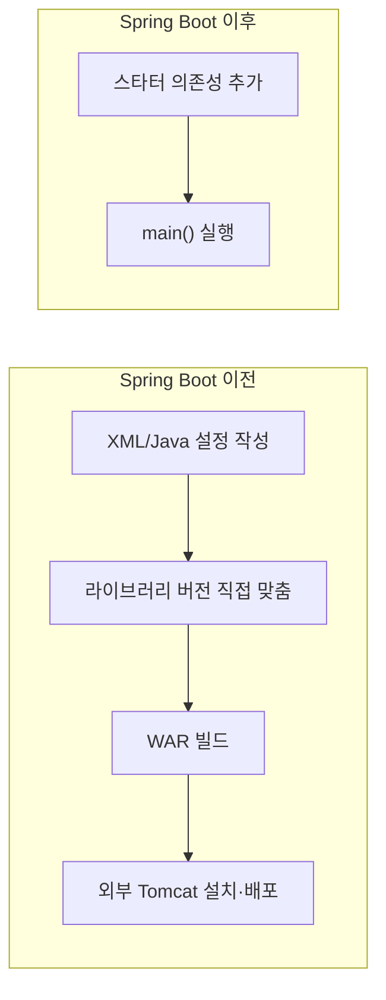
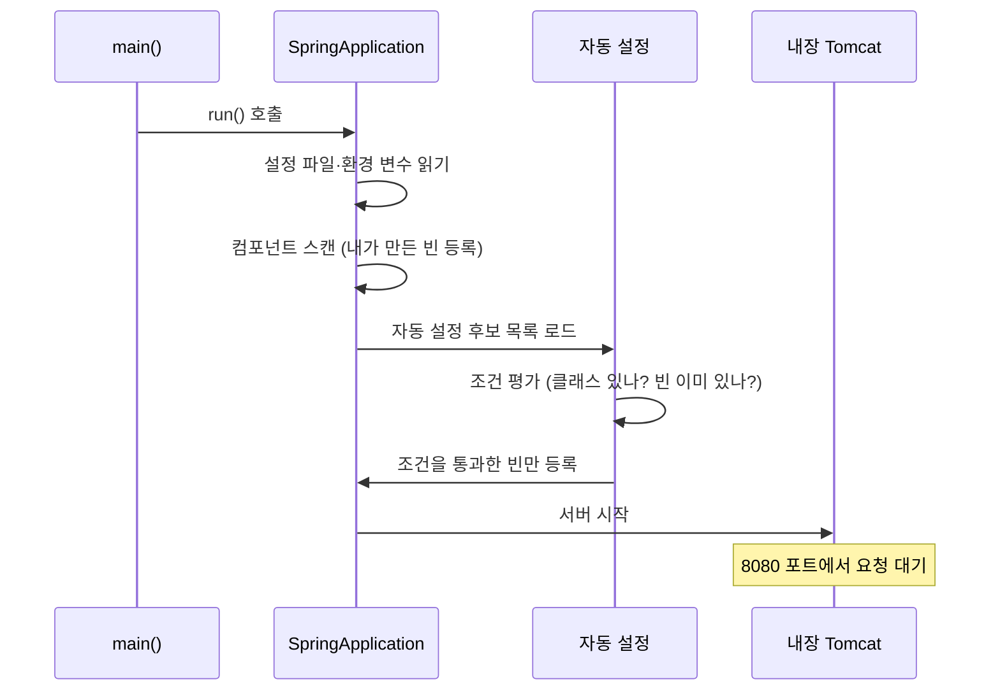

# Spring Boot 딥다이브

> 탄생 배경 → 핵심 원리 → 사용법 → 진화 과정 → 응용과 실무 → 대안과 트레이드오프 순서로 정리한 학습 노트.
> 그림은 Mermaid로 작성했다. 버전 정보 확인 시점: 2026-11-14

---

## 1. 탄생 배경 — 왜 생겼는가

### 내가 이 주제를 파게 된 이유

> (직접 채워 넣기: 어떤 상황에서 Spring Boot를 쓰게 됐고, 무엇이 궁금했는지)

### 이전에는 어떻게 했나: 설정이 코드보다 많던 시절

Spring Framework는 2004년 3월 1.0이 나온 뒤 자바 서버 개발의 표준이 됐다. 문제는 "Hello World" 하나를 띄우려 해도 해야 할 일이 너무 많았다는 점이다.

```xml
<!-- web.xml: 서블릿 컨테이너에게 Spring을 알려주는 설정 -->
<servlet>
  <servlet-name>dispatcher</servlet-name>
  <servlet-class>org.springframework.web.servlet.DispatcherServlet</servlet-class>
  <init-param>
    <param-name>contextConfigLocation</param-name>
    <param-value>/WEB-INF/spring/servlet-context.xml</param-value>
  </init-param>
</servlet>
<!-- 여기에 더해 servlet-context.xml, root-context.xml, 뷰 리졸버, 데이터소스, 트랜잭션 매니저 ... -->
```

### 구체적인 고통

- **설정 지옥.** 프로젝트마다 거의 똑같은 XML(나중에는 Java Config)을 복사해 붙였다. 비즈니스 코드 한 줄 쓰기 전에 설정만 수백 줄이었다.
- **의존성 버전 지옥.** Spring, Hibernate, Jackson, 로깅 라이브러리의 버전을 손으로 맞춰야 했다. 하나만 어긋나도 `NoSuchMethodError`가 났다.
- **배포의 번거로움.** 애플리케이션을 WAR로 묶어서, 따로 설치해 둔 Tomcat에 올려야 했다. 서버 설정이 애플리케이션 밖에 있으니 "내 PC에서는 되는데"가 흔했다.



### 누가, 언제 만들었나

| 시점 | 사건 |
|---|---|
| 2012년 | Spring 이슈 트래커에 "컨테이너 없는(containerless) 웹 애플리케이션 아키텍처 지원 개선" 요청(SPR-9888)이 올라옴 |
| 2013년 8월 | Spring 팀의 Phil Webb이 "이걸 Spring Framework 안에서 고치지 않고 Spring Boot라는 새 프로젝트를 시작한다"고 답함 |
| 2014년 4월 1일 | Pivotal이 Spring Boot 1.0 GA 출시. 주요 개발자는 Phil Webb, Dave Syer |

당시 배경에는 클라우드/PaaS와 마이크로서비스가 있었다. 서비스를 작게 여러 개 띄우려면, 서비스 하나를 만드는 비용이 낮아야 했다.

### 핵심 아이디어 한 줄

대부분이 똑같이 하는 설정은 미리 정해 두고(opinionated), 다르게 하고 싶은 것만 덮어쓰게 한다. 그리고 `main()` 하나로 실행한다.

---

## 2. 핵심 원리 — 어떻게 동작하는가

### ① 스타터 (starter): 의존성 묶음

`spring-boot-starter-web` 하나를 추가하면 Spring MVC, 내장 Tomcat, Jackson, 로깅이 **서로 호환되는 버전으로** 따라온다. 버전 지옥을 Spring Boot가 대신 관리한다.

### ② 자동 설정 (auto-configuration): 조건부 빈 등록

Spring Boot의 심장이다. "클래스패스에 무엇이 있는지, 개발자가 이미 무엇을 등록했는지"를 보고 빈을 조건부로 등록한다.

```java
@AutoConfiguration
@ConditionalOnClass(DataSource.class)          // JDBC 라이브러리가 있으면
public class DataSourceAutoConfiguration {

    @Bean
    @ConditionalOnMissingBean                  // 개발자가 직접 만든 DataSource가 없을 때만
    public DataSource dataSource(DataSourceProperties props) { ... }
}
```

- `@ConditionalOnClass`: 특정 라이브러리가 있을 때만 동작한다.
- `@ConditionalOnMissingBean`: **개발자가 직접 등록하면 자동 설정이 물러난다.** "관례 우선, 필요하면 덮어쓰기"가 이 어노테이션으로 구현된다.

### ③ 내장 서버 (embedded server)

Tomcat을 따로 설치하지 않는다. Tomcat이 라이브러리로 애플리케이션 안에 들어 있고, `main()`이 Tomcat을 띄운다. 결과물은 `java -jar app.jar`로 실행되는 JAR 하나다.

### ④ 외부화된 설정 (externalized configuration)

`application.yml`, 환경 변수, 실행 인자를 한 가지 방식으로 읽는다. 같은 JAR을 개발·운영 환경에 그대로 쓰고 설정만 바꾼다.

### ⑤ 액추에이터 (Actuator)

헬스 체크, 메트릭 같은 운영 기능을 엔드포인트로 제공한다. "운영 준비(production-ready)"가 Spring Boot의 목표 중 하나였다.

### 시작 과정 한눈에 보기



### 비유와 그 한계

Spring Framework가 부품 상자라면, Spring Boot는 "기본 옵션이 다 달린 완성차"다. 다만 완성차와 달리 **모든 부품을 내가 바꿔 끼울 수 있다.** 그리고 기본 옵션이 왜 그렇게 돼 있는지 모르면, 문제가 났을 때 어디를 봐야 할지 알 수 없다. "마법"이 아니라 조건문이라는 점을 기억해야 한다.

---

## 3. 사용법 — 어떻게 쓰는가

### 의존성 (build.gradle)

```groovy
plugins {
    id 'java'
    id 'org.springframework.boot' version '4.1.1'   // 실제 프로젝트에서는 start.spring.io가 주는 값 사용
    id 'io.spring.dependency-management' version '1.1.7'
}

dependencies {
    implementation 'org.springframework.boot:spring-boot-starter-web'   // ① 스타터
}
```

> Spring Boot 4에서 일부 스타터 이름이 바뀐 것으로 알고 있으나(예: web 계열) 직접 확인하지 못했다. 새 프로젝트는 [start.spring.io](https://start.spring.io)에서 생성한 값을 그대로 쓰는 것이 안전하다.

### 메인 클래스

```java
@SpringBootApplication        // ② 자동 설정 + 컴포넌트 스캔을 켜는 스위치
public class DemoApplication {
    public static void main(String[] args) {
        SpringApplication.run(DemoApplication.class, args);   // ③ 내장 서버까지 띄움
    }
}
```

`@SpringBootApplication`은 세 어노테이션의 묶음이다.

- `@SpringBootConfiguration`: 이 클래스가 설정 클래스다.
- `@EnableAutoConfiguration`: ②의 자동 설정을 켠다.
- `@ComponentScan`: 이 클래스의 패키지 아래를 훑어 빈을 찾는다.

### 컨트롤러와 설정

```java
@RestController
public class HelloController {
    @GetMapping("/hello")
    public String hello() { return "hello"; }
}
```

```yaml
# application.yml  — ④ 외부화된 설정
server:
  port: 8081
```

### 처음 쓰는 사람이 자주 하는 실수

1. **메인 클래스 위치.** 컴포넌트 스캔은 메인 클래스의 패키지 "아래"만 본다. 메인 클래스가 `com.example.app`에 있는데 컨트롤러가 `com.example.web`에 있으면 빈으로 등록되지 않고 404가 난다. 메인 클래스는 최상위 패키지에 둔다.
2. **자동 설정이 뭘 했는지 모른 채 덮어쓴다.** 빈을 직접 등록하면 `@ConditionalOnMissingBean` 때문에 관련 자동 설정이 통째로 빠질 수 있다. `--debug` 옵션으로 실행하면 어떤 자동 설정이 적용됐고 왜 빠졌는지 보고서(conditions report)가 출력된다.

---

## 4. 진화 과정 — 어떻게 바뀌어 왔는가

| 버전 | 시기 | 드러난 한계 → 바뀐 것 |
|---|---|---|
| 1.0 | 2014-04 | 설정·배포의 번거로움 → 자동 설정, 스타터, 내장 서버 |
| 2.0 | 2018-03 | 동기 방식만으로는 고동시성 처리에 한계 → Spring Framework 5 기반, 리액티브(WebFlux) 지원. 1.0 이후 약 4년 만의 첫 메이저 |
| 2.4 | 2020-11 | 버전 표기와 설정 파일 처리 정리 → 버전에서 `.RELEASE` 접미사 제거 |
| 2.7 | 2022-05 | 자동 설정 등록 파일(`spring.factories`)에 온갖 것이 섞여 있음 → 자동 설정 전용 등록 파일 도입 (기억 기준) |
| 3.0 | 2022-11 | Java 8 기반과 `javax.*` 패키지의 노후화 → Java 17 최소, `jakarta.*`로 이전, GraalVM 네이티브 이미지 지원 (세부는 기억 기준) |
| 3.2 | 2023-11 | 스레드 수가 동시성의 한계 → Java 21과 가상 스레드(virtual threads) 지원 |
| 4.0 | 2025-11-20 | 새 세대의 기반 필요 → Spring Framework 7 기반. Java 17 이상 |
| 4.1 | 2026-06-10 | 현재 신규 프로젝트 권장 대상. 최신 패치 4.1.1 (2026-08-20) |

- 출시 주기는 6개월(5월, 11월)이고 4.2가 2026년 11월로 예정돼 있다.
- 오픈소스 지원 기간은 대략 출시 후 12~13개월이다. 3.5는 2026년 6월 30일에 오픈소스 지원이 끝났다.

### 옛 자료에서 헷갈리기 쉬운 것

- **`javax.persistence`, `javax.servlet` import.** 3.0 이전 코드다. 지금은 `jakarta.*`다. 옛 블로그 코드를 붙였는데 컴파일이 안 되면 대부분 이 문제다.
- **`2.3.4.RELEASE` 같은 버전 표기.** 2.4부터 `.RELEASE`가 빠졌다.
- **`extends WebSecurityConfigurerAdapter`.** Spring Security 6(Boot 3)에서 제거됐다. (Spring Security 문서 참고)
- **WAR 빌드 후 외부 Tomcat 배포.** 지금도 가능하지만 기본은 실행 가능한 JAR이다.
- **`spring.factories`에 자동 설정 등록.** 지금은 전용 파일(`META-INF/spring/...AutoConfiguration.imports`)을 쓴다. (기억 기준)

### 현재 권장 방식과 방향

- 새 프로젝트는 Spring Boot 4.x + Java 17 이상(가능하면 21 이상)으로 시작한다.
- 6개월마다 마이너 버전이 나오고 지원 기간이 1년 남짓이므로, **버전 업그레이드를 정기 작업으로** 잡아야 한다.
- 방향은 시작 속도와 메모리(네이티브 이미지, AOT)와 가상 스레드 활용이다.

---

## 5. 응용과 실무 — 현업에서는 어떻게 쓰는가

> 이 단계는 일반적으로 통용되는 실무 지식이다. 기본값은 버전에 따라 달라질 수 있으니 쓰는 버전의 문서로 확인할 것.

### 흔한 사용 패턴

- **프로파일(profile)로 환경 분리.** `application-local.yml`, `application-prod.yml`을 두고 `spring.profiles.active`로 고른다.
- **비밀 값은 파일에 넣지 않는다.** DB 비밀번호 등은 환경 변수나 시크릿 매니저로 주입한다. 환경 변수가 yml보다 우선순위가 높다는 점을 이용한다.
- **`@ConfigurationProperties`로 설정을 객체에 묶는다.** `@Value`를 여기저기 흩뿌리는 것보다 타입 안전하고 검증하기 쉽다.

### 운영하면서 만나는 문제

| 문제 | 설명 | 대응 |
|---|---|---|
| 액추에이터 노출 | `/actuator/env`, `/heapdump` 등이 외부에 열리면 비밀 값이 샌다 | 필요한 엔드포인트만 노출하고 인증을 건다 |
| 배포 중 요청 유실 | 종료 신호에 즉시 죽으면 처리 중이던 요청이 끊긴다 | graceful shutdown 설정 |
| 커넥션 풀 고갈 | 기본 풀(HikariCP)의 최대 크기는 10이다 | 트랜잭션을 짧게 유지하고, DB의 최대 연결 수를 넘지 않게 조정 |
| OSIV | `spring.jpa.open-in-view` 기본값이 true라 요청 내내 DB 커넥션을 쥔다 | API 서버에서는 false로 두는 경우가 많다 |
| 느린 시작 | 빈이 많아질수록 시작이 느려진다 | 불필요한 스타터 제거, 필요하면 AOT·네이티브 이미지 검토 |

### 모니터링 지점

- 액추에이터 + Micrometer로 JVM 메모리, GC, 커넥션 풀 사용량, HTTP 응답 시간을 수집한다.
- 헬스 체크 엔드포인트를 로드밸런서나 쿠버네티스의 probe에 연결한다.

### 쓰지 말아야 할 상황

- 실행 시간이 짧고 시작 속도가 중요한 작은 CLI나 서버리스 함수. 시작 비용이 실행 비용보다 클 수 있다.
- 프레임워크 없이도 충분한 아주 단순한 프로그램.

---

## 6. 대안과 트레이드오프

| 기술 | 특징 | 고르는 조건 |
|---|---|---|
| Spring Boot | 생태계와 자료가 가장 많다. 런타임에 조건을 평가해 유연하지만 시작이 상대적으로 느리다 | 일반적인 서버, 팀에 Spring 경험이 있을 때. 국내 채용 시장의 사실상 기본값 |
| Spring Framework 단독 | 모든 설정을 직접 한다 | 레거시 유지보수 외에는 거의 고르지 않는다 |
| Quarkus, Micronaut | 빌드 시점에 설정을 처리해 시작이 빠르고 메모리를 적게 쓴다 | 서버리스, 컨테이너를 자주 띄웠다 내리는 환경 |
| 다른 언어 프레임워크 (NestJS, FastAPI, Go 등) | 언어와 생태계 자체가 다르다 | 팀의 주 언어가 자바가 아닐 때 |

**판단 기준:** 시작 속도·메모리가 최우선 제약이 아니고 팀이 자바/스프링을 쓴다면 Spring Boot다. 시작 시간이 과금이나 확장 속도에 직접 영향을 주는 환경이면 네이티브 이미지나 Quarkus·Micronaut를 비교한다.

---

## 마무리

### 요약

Spring Framework는 강력했지만 설정, 버전 맞추기, 배포가 너무 번거로웠다. Spring Boot는 2014년에 "관례로 정해 두고 필요한 것만 덮어쓴다"는 생각으로 이 문제를 풀었다. 핵심은 조건부로 빈을 등록하는 자동 설정이고, 스타터와 내장 서버가 이를 받친다. 지금은 6개월마다 새 버전이 나오는 자바 서버 개발의 기본 출발점이며, 4.x 세대는 Spring Framework 7 위에서 동작한다.

### 다음에 파볼 주제

- Spring IoC 컨테이너와 빈 생명주기: 자동 설정이 등록하는 "빈"이 무엇인가
- Spring MVC 요청 처리 흐름: DispatcherServlet에서 컨트롤러까지
- AOP와 프록시: `@Transactional`, 보안이 동작하는 방식의 뿌리

---

## 출처

- [Spring Boot 1.0 GA Released (spring.io)](https://spring.io/blog/2014/04/01/spring-boot-1-0-ga-released)
- [Spring Boot 1.0 Launches (ADTmag)](https://adtmag.com/Articles/2014/04/09/Spring-Boot-Launch.aspx)
- [Spring Boot 2.0 (ADTmag)](https://adtmag.com/Articles/2018/03/28/spring-boot-2-0.aspx)
- [Spring and Spring Boot Frameworks: A Brief History (DZone)](https://dzone.com/articles/history-of-spring-framework-spring-boot-framework)
- [Spring Boot 1.0 (noze)](https://www.noze.it/en/insights/spring-boot-1-0/)
- [Spring Boot version history (CodeJava)](https://codejava.net/frameworks/spring-boot/spring-boot-version-history)
- [Spring Boot 4.0.0 available now (spring.io)](https://spring.io/blog/2025/11/20/spring-boot-4-0-0-available-now/)
- [Spring Boot 4.1.0 available now (spring.io)](https://spring.io/blog/2026/06/10/spring-boot-4/)
- [Spring Boot Versions, EOL Dates, and Latest Releases (HeroDevs)](https://www.herodevs.com/blog-posts/spring-boot-versions-eol-dates-and-latest-releases-april-2026)
- [Spring Boot Releases (Versio.io)](https://www.versio.io/de/product-release-end-of-life-eol-broadcom-spring-boot.html)
- [Spring And Spring Boot Versions (Marco Behler)](https://www.marcobehler.com/guides/spring-and-spring-boot-versions)
- [History of Spring Framework and Spring Boot](https://quickprogrammingtips.com/spring-boot/history-of-spring-framework-and-spring-boot.html)
