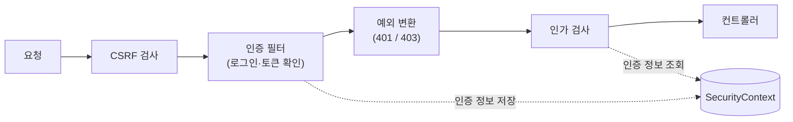
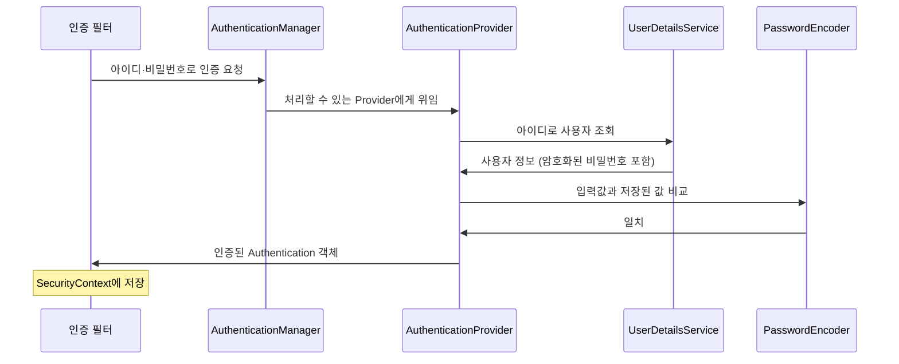
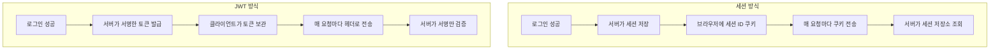

# Spring Security 딥다이브

> 탄생 배경 → 핵심 원리 → 사용법 → 진화 과정 → 응용과 실무 → 대안과 트레이드오프 순서로 정리한 학습 노트.
> 그림은 Mermaid로 작성했다. 버전 정보 확인 시점: 2026-11-14

---

## 1. 탄생 배경 — 왜 생겼는가

### 내가 이 주제를 파게 된 이유

> (직접 채워 넣기: 어떤 상황에서 Spring Security를 쓰게 됐고, 무엇이 궁금했는지)

### 이전에는 어떻게 했나

보안에는 두 가지 질문이 있다.

- **인증(authentication):** 너는 누구인가?
- **인가(authorization):** 너는 이걸 해도 되는가?

Spring Security 이전에는 이 질문을 크게 두 가지 방식으로 풀었다.

**방식 1: 컨트롤러마다 직접 검사**

```java
@GetMapping("/admin/users")
public String users(HttpSession session) {
    User user = (User) session.getAttribute("user");
    if (user == null) return "redirect:/login";          // 인증 검사
    if (!user.isAdmin()) throw new ForbiddenException(); // 인가 검사
    // ... 여기부터가 진짜 로직
}
```

**방식 2: 서블릿 컨테이너의 보안 기능 (`web.xml`의 security-constraint)**

Tomcat, WebLogic 같은 컨테이너가 제공하는 보안 설정을 쓰는 방식이다.

### 구체적인 고통

- **중복과 누락.** 방식 1은 모든 메서드에 같은 코드가 반복된다. 한 군데만 빠뜨려도 그곳이 구멍이다. 보안은 "하나라도 빠지면 실패"인 영역이라 치명적이다.
- **비즈니스 코드 오염.** 진짜 로직이 보안 검사 코드에 파묻힌다.
- **이식성 없음.** 방식 2는 컨테이너마다 설정이 달라서, 서버를 바꾸면 보안 설정을 다시 해야 했다.

### 누가, 언제 만들었나

| 시점 | 사건 |
|---|---|
| 2003년 말 | Ben Alex가 "Acegi Security System for Spring"이라는 이름으로 시작 |
| 2004년 3월 | Apache 라이선스로 공개 |
| 이후 | Spring 포트폴리오에 편입되며 Spring Security로 이름 변경 (2.0, 2008년 무렵 — 연도는 기억 기준) |

Acegi라는 이름은 알파벳의 1, 3, 5, 7, 9번째 글자(A, C, E, G, I)를 딴 것이다. 다른 프로젝트와 이름이 겹치지 않게 하려는 의도였다.

### 핵심 아이디어 한 줄

보안 검사를 비즈니스 코드에서 떼어내, 요청이 컨트롤러에 닿기 **전에** 거치는 필터 체인(filter chain)에 모은다.

---

## 2. 핵심 원리 — 어떻게 동작하는가

### ① 필터 체인 (SecurityFilterChain): 컨트롤러 앞의 검문소들

요청은 컨트롤러에 도달하기 전에 여러 개의 보안 필터를 순서대로 통과한다. 필터 하나가 한 가지 일만 한다.



- 어느 필터에서든 통과하지 못하면 요청은 컨트롤러까지 가지 못한다.
- 실제 필터는 더 많지만(15개 안팎), 큰 흐름은 "인증 → 인가"다.

### ② 인증 (Authentication): 누구인지 확인하는 부품들



- `UserDetailsService`: "아이디로 사용자를 어떻게 찾는가". 보통 이것만 직접 구현한다.
- `PasswordEncoder`: 비밀번호를 단방향 해시(BCrypt 등)로 저장하고 비교한다.

### ③ SecurityContext: "지금 이 요청의 주인"을 담는 곳

인증에 성공하면 결과(`Authentication`)를 `SecurityContextHolder`에 넣는다. 기본적으로 스레드에 묶여 있어서, 같은 요청을 처리하는 코드 어디서든 꺼낼 수 있다. 컨트롤러에서 `@AuthenticationPrincipal`로 받는 값이 여기서 온다.

### ④ 인가 (Authorization): 해도 되는지 판단

두 군데에서 검사할 수 있다.

- **URL 단위:** "`/admin/**`은 ADMIN만". 필터 체인에서 처리한다.
- **메서드 단위:** `@PreAuthorize("hasRole('ADMIN')")`. 서비스 메서드에 붙이며 AOP 프록시로 동작한다.

### ⑤ 예외 처리: 401과 403의 구분

- **401 Unauthorized:** 누구인지 모른다 (인증 안 됨). 로그인 페이지로 보내거나 401을 준다.
- **403 Forbidden:** 누구인지는 알지만 권한이 없다.

### 비유와 그 한계

건물 출입과 같다. 로비에서 신분증을 확인하고(인증), 출입증에 적힌 층만 갈 수 있다(인가). 필터 체인은 로비에서 엘리베이터까지 이어진 검문소들이다.

다만 실제 건물과 달리 **HTTP는 요청마다 처음 온 사람 취급을 한다.** 그래서 "한 번 확인한 사람"을 기억하는 수단(세션 쿠키나 토큰)이 매 요청에 따라와야 하고, 그 수단을 탈취당하면 신분증을 통째로 뺏긴 것과 같다.

---

## 3. 사용법 — 어떻게 쓰는가

Spring Security 6/7 기준(Spring Boot 3/4). 설정은 람다 DSL로 쓴다.

### 의존성

```groovy
implementation 'org.springframework.boot:spring-boot-starter-security'
```

의존성만 추가해도 모든 URL에 인증이 걸리고 기본 로그인 폼이 생긴다. Spring Boot의 자동 설정이 기본 필터 체인을 등록하기 때문이다.

### 기본 설정: 폼 로그인 + 세션

```java
@Configuration
@EnableWebSecurity
public class SecurityConfig {

    @Bean
    SecurityFilterChain filterChain(HttpSecurity http) throws Exception {   // ① 필터 체인 정의
        http
            .authorizeHttpRequests(auth -> auth                             // ④ URL 단위 인가
                .requestMatchers("/", "/login", "/api/public/**").permitAll()
                .requestMatchers("/admin/**").hasRole("ADMIN")
                .anyRequest().authenticated())
            .formLogin(Customizer.withDefaults());                          // ② 폼 로그인 인증 필터
        return http.build();
    }

    @Bean
    PasswordEncoder passwordEncoder() {                                     // ② 비밀번호 비교
        return PasswordEncoderFactories.createDelegatingPasswordEncoder();
    }

    @Bean
    UserDetailsService userDetailsService(UserRepository users) {           // ② 사용자 조회
        return username -> users.findByEmail(username)
            .map(u -> User.withUsername(u.getEmail())
                          .password(u.getPassword())
                          .roles(u.getRole())
                          .build())
            .orElseThrow(() -> new UsernameNotFoundException(username));
    }
}
```

### REST API용: JWT + 무상태

```java
@Bean
SecurityFilterChain apiChain(HttpSecurity http) throws Exception {
    http
        .csrf(csrf -> csrf.disable())                                        // 쿠키 인증을 안 쓰므로
        .sessionManagement(s -> s.sessionCreationPolicy(SessionCreationPolicy.STATELESS))
        .authorizeHttpRequests(auth -> auth
            .requestMatchers("/api/auth/**").permitAll()
            .anyRequest().authenticated())
        .oauth2ResourceServer(o -> o.jwt(Customizer.withDefaults()));        // Bearer 토큰 검증 필터
    return http.build();
}
```

### 컨트롤러에서 현재 사용자 꺼내기

```java
@GetMapping("/api/me")
public String me(@AuthenticationPrincipal UserDetails user) {   // ③ SecurityContext에서 옴
    return user.getUsername();
}
```

### 처음 쓰는 사람이 자주 하는 실수

1. **CSRF를 이유 없이 끈다.** `csrf.disable()`은 "쿠키로 인증하지 않을 때"만 안전하다. 세션 쿠키로 인증하면서 CSRF를 끄면 다른 사이트가 사용자 몰래 요청을 보낼 수 있다.
2. **`hasRole`과 `hasAuthority`를 섞는다.** `hasRole("ADMIN")`은 내부적으로 `ROLE_ADMIN`을 찾는다. 권한을 `ADMIN`으로 저장해 놓고 `hasRole("ADMIN")`을 쓰면 항상 403이 난다.
3. **커스텀 필터에 `@Component`를 붙인다.** Spring Boot가 그 필터를 서블릿 필터로도 자동 등록해서, 보안 체인 안팎에서 두 번 실행될 수 있다. 보안 체인에만 넣으려면 `@Component` 없이 `addFilterBefore`로 직접 추가한다.

---

## 4. 진화 과정 — 어떻게 바뀌어 왔는가

| 시기 | 드러난 한계 → 바뀐 것 |
|---|---|
| 2003~2004 Acegi | 보안 코드의 중복 → 필터 기반 보안. 하지만 XML 설정이 수백 줄로 악명 높았다 |
| 2008 무렵 Spring Security 2.0 | 장황한 XML → 보안 전용 네임스페이스(`<http>`)로 설정 축소 (기억 기준) |
| 3.x | URL 패턴만으로는 부족한 인가 규칙 → 표현식 기반 접근 제어(`hasRole(...)`), 이후 Java Config 도입 (기억 기준) |
| 5.0 (2017 무렵) | 외부 프로젝트였던 OAuth 지원의 분산 → OAuth2 로그인·리소스 서버 내장, 비밀번호 인코더 위임 방식 (기억 기준) |
| 5.7 (2022) | 상속 기반 설정(`WebSecurityConfigurerAdapter`)의 경직성 → 어댑터를 deprecated 처리하고 `SecurityFilterChain` 빈 방식 권장 |
| 6.0 (2022-11, Boot 3.0) | 옛 API 정리 → 어댑터와 `antMatchers()` 제거 |
| 7.0 (Boot 4.0) | 체이닝 방식의 모호함 → `authorizeRequests()`, `and()`, 인자 없는 `csrf()`·`formLogin()` 제거. 람다 DSL이 유일한 방식 |

### 옛 자료에서 헷갈리기 쉬운 것

인터넷 자료의 상당수가 5.x 시절 코드다. 아래가 보이면 옛 코드다.

| 옛 API | 지금 |
|---|---|
| `extends WebSecurityConfigurerAdapter` | `@Bean SecurityFilterChain` |
| `configure(HttpSecurity http)` 오버라이드 | 빈 메서드 안에서 `http` 설정 후 `http.build()` |
| `configure(AuthenticationManagerBuilder auth)` | `@Bean UserDetailsService` + `@Bean PasswordEncoder` |
| `antMatchers()`, `mvcMatchers()` | `requestMatchers()` |
| `authorizeRequests()` | `authorizeHttpRequests(auth -> ...)` |
| `http.csrf().disable().and()...` | `http.csrf(csrf -> csrf.disable())` |
| `@EnableGlobalMethodSecurity` | `@EnableMethodSecurity` (기억 기준) |

### 현재 권장 방식과 방향

- 설정 클래스를 상속하지 않고, `SecurityFilterChain`을 빈으로 등록한다.
- 모든 설정은 람다 DSL로 쓴다.
- JWT 검증 필터를 직접 만들기 전에 내장된 `oauth2ResourceServer`를 먼저 검토한다.
- 방향은 비밀번호 없는 인증(패스키 등)과 OAuth2/OIDC 표준 지원 강화다. (기억 기준)

---

## 5. 응용과 실무 — 현업에서는 어떻게 쓰는가

> 이 단계는 일반적으로 통용되는 실무 지식이다.

### 세션 방식과 토큰 방식



### 흔한 사용 패턴

- **액세스 토큰은 짧게, 리프레시 토큰은 길게.** 액세스 토큰은 탈취돼도 금방 만료되게 하고, 리프레시 토큰으로 재발급한다. 리프레시 토큰은 서버에 저장해 두고 강제 만료할 수 있게 한다.
- **CORS 설정.** 프론트엔드와 도메인이 다르면 `CorsConfigurationSource` 빈으로 허용 출처를 명시한다. `*`와 인증 정보 허용을 함께 쓸 수 없다.
- **메서드 보안으로 소유권 검사.** "본인 글만 수정" 같은 규칙은 URL로 표현이 안 된다. `@PreAuthorize`나 서비스 로직에서 검사한다.
- **401/403 응답을 JSON으로 통일.** API 서버는 로그인 페이지로 리다이렉트하면 안 된다. `AuthenticationEntryPoint`와 `AccessDeniedHandler`를 구현한다.

### 운영하면서 만나는 문제

| 문제 | 설명 | 대응 |
|---|---|---|
| JWT 강제 만료 불가 | 서명만 검증하므로 발급된 토큰을 서버가 취소할 수 없다 | 만료를 짧게, 필요하면 차단 목록 운영 |
| 토큰 저장 위치 | localStorage는 XSS에, 쿠키는 CSRF에 노출된다 | HttpOnly·Secure·SameSite 쿠키 또는 메모리 보관 + 리프레시 |
| 세션 서버 확장 | 서버가 여러 대면 세션을 공유해야 한다 | Redis 등 외부 세션 저장소 |
| 비밀번호 해시 비용 | BCrypt는 일부러 느리다. 로그인 폭주 시 CPU를 쓴다 | 강도(cost) 조정, 로그인 시도 제한 |
| 권한 변경 반영 지연 | 토큰에 권한을 넣으면 만료 전까지 옛 권한이 유지된다 | 민감한 권한은 요청 시 DB 확인 |

### 모니터링 지점

- 로그인 실패 횟수와 계정별·IP별 분포 (무차별 대입 공격 탐지)
- 401·403 응답 비율의 급변
- 관리자 기능 접근 기록 (감사 로그)

### 쓰지 말아야 할 상황

- 인증을 앞단(API 게이트웨이, 사이드카)에서 전부 처리하고 내부 서비스는 신뢰하는 구조라면, 각 서비스의 Spring Security는 최소 설정으로 충분하다.

---

## 6. 대안과 트레이드오프

### 세션 vs JWT

| | 세션 | JWT |
|---|---|---|
| 상태 | 서버가 저장 (stateful) | 서버가 저장하지 않음 (stateless) |
| 강제 로그아웃 | 쉽다 (세션 삭제) | 어렵다 |
| 서버 확장 | 세션 저장소 공유 필요 | 서명 키만 공유하면 된다 |
| 잘 맞는 곳 | 서버 렌더링 웹, 관리자 페이지 | 모바일 앱, 여러 서비스가 같은 토큰을 검증하는 구조 |

**판단 기준:** 브라우저만 상대하고 서버가 한 덩어리면 세션이 단순하고 안전하다. 모바일 앱이 있거나 여러 서비스가 인증 결과를 공유해야 하면 JWT다. "요즘은 JWT"라는 이유만으로 고르지 않는다.

### 직접 구현 vs 외부 인증 서버

- **Spring Security로 직접 구현.** 사용자 DB를 직접 관리한다. 통제권이 크고 비용이 없지만 보안 책임도 전부 진다.
- **외부 IdP (Keycloak, Auth0, 소셜 로그인 등).** 로그인·MFA·비밀번호 재설정을 맡긴다. 서비스는 토큰 검증만 한다. 인증이 핵심 기능이 아닌 서비스에 맞는다.

### 다른 선택지

- **인터셉터/필터 직접 구현.** 학습용이나 아주 단순한 경우에만. 놓치는 공격 벡터(세션 고정, CSRF, 타이밍 공격 등)가 많다.
- **Apache Shiro.** 더 단순한 자바 보안 프레임워크. Spring 생태계와의 통합은 Spring Security가 낫다.

---

## 마무리

### 요약

보안 검사를 컨트롤러마다 손으로 넣으면 중복되고 누락되기 쉬웠다. Spring Security는 2003년 Acegi로 시작해, 검사를 컨트롤러 앞의 필터 체인으로 분리했다. 인증은 `AuthenticationManager`와 `UserDetailsService`가, 인가는 URL 규칙과 메서드 어노테이션이 담당하고, 결과는 `SecurityContext`에 담긴다. 지금은 `SecurityFilterChain` 빈과 람다 DSL이 유일한 설정 방식이며, 옛 자료의 상속 기반 코드는 더 이상 동작하지 않는다.

### 다음에 파볼 주제

- OAuth 2.0과 OpenID Connect: 소셜 로그인의 인가 코드 흐름
- JWT 구조와 서명: 헤더·페이로드·서명, 대칭키와 비대칭키
- 웹 공격 기초: XSS, CSRF, 세션 고정이 실제로 어떻게 일어나는가

---

## 출처

- [Spring Security without the WebSecurityConfigurerAdapter (spring.io)](https://spring.io/blog/2022/02/21/spring-security-without-the-websecurityconfigureradapter)
- [WebSecurityConfigurerAdapter Deprecated: Migration Guide (HowToDoInJava)](https://howtodoinjava.com/spring-security/configurations-without-websecurityconfigureradapter/)
- [Spring Security 6.0.0-M3 and 5.7.0-M3 available now (spring.io)](https://spring.io/blog/2022/03/22/spring-security-6-0-0-m3-and-5-7-0-m3-available-now)
- [Spring Security 5.7 deprecated list (Javadoc)](https://javadoc.io/static/org.springframework.security/spring-security-config/5.7.0/deprecated-list.html)
- [Spring Security (Wikipedia 미러)](https://demo.azizisearch.com/lite/wikipedia/page/Spring_Security)
- [Spring Security Introduction (TPointTech)](https://www.tpointtech.com/spring-security-introduction)
