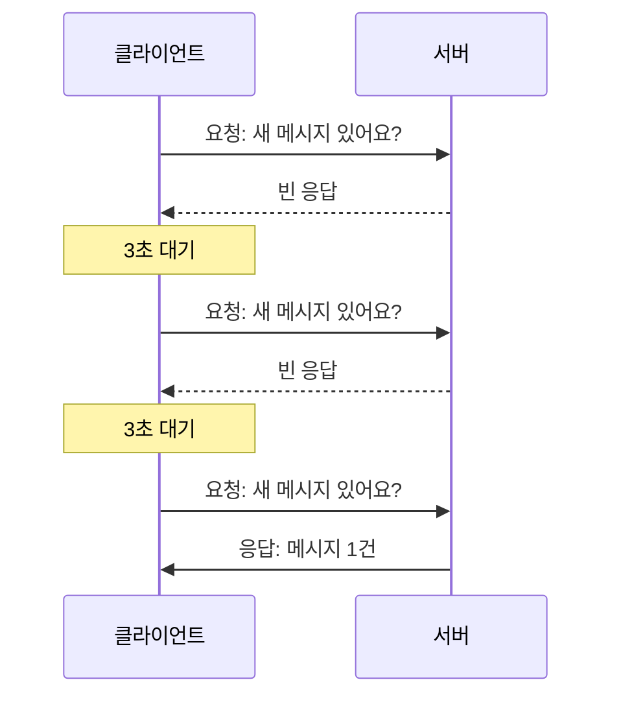
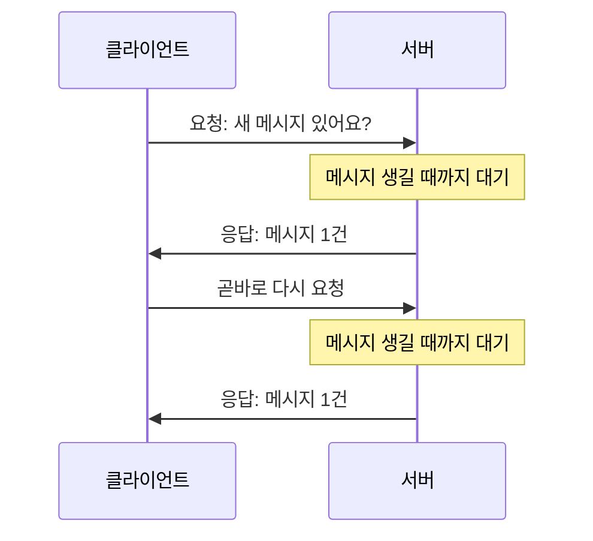
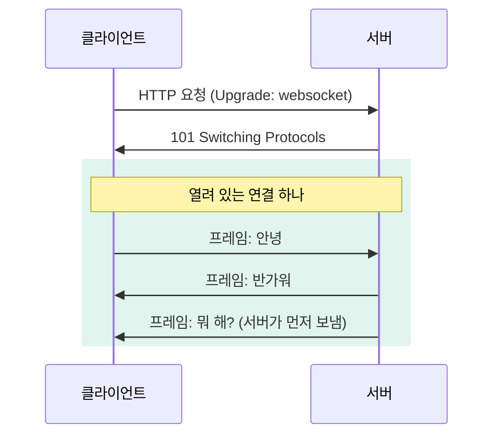
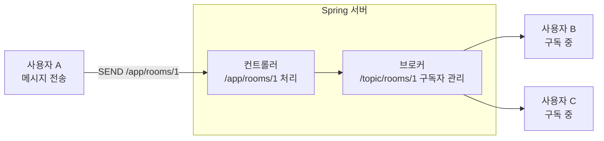
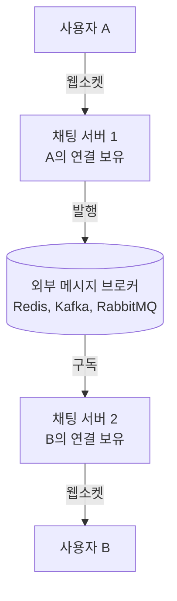
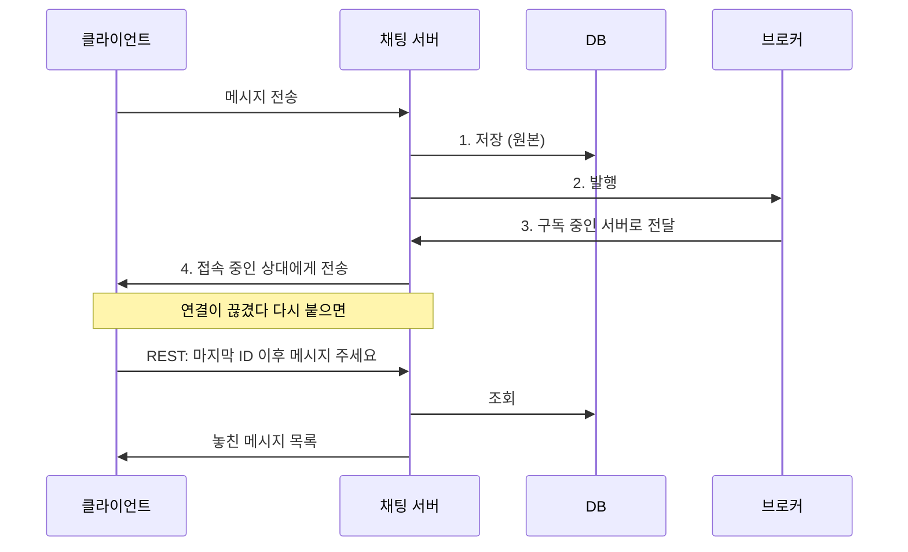
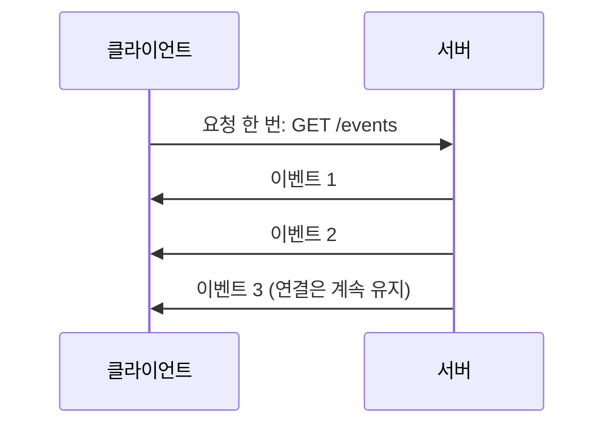

# 백엔드 채팅 딥다이브

## 목차

1. [탄생 배경 — 왜 생겼는가](#1-탄생-배경--왜-생겼는가)
2. [핵심 원리 — 어떻게 동작하는가](#2-핵심-원리--어떻게-동작하는가)
3. [사용법 — 어떻게 쓰는가](#3-사용법--어떻게-쓰는가)
4. [진화 과정 — 어떻게 바뀌어 왔는가](#4-진화-과정--어떻게-바뀌어-왔는가)
5. [응용과 실무 — 현업에서는 어떻게 쓰는가](#5-응용과-실무--현업에서는-어떻게-쓰는가)
6. [대안과 트레이드오프](#6-대안과-트레이드오프)
7. [마무리](#마무리)
8. [출처](#출처)

---

## 1. 탄생 배경 — 왜 생겼는가

### 해당 주제를 학습하게 된 이유

채팅 기능이 필요해서 공부를 시작했다. 처음에는 기능을 붙이는 방법만 알면 될 줄 알았는데, 동작 방식을 이해하려고 하나씩 따라가다 보니 "왜 이렇게 생겼는가"까지 거슬러 올라가게 됐다. 이 문서는 그 과정을 처음부터 순서대로 정리한 것이다.

### 문제: HTTP에서는 서버가 먼저 말을 걸 수 없다

#### 기술적 딥다이브: HTTP와 TCP를 분리해서 이해하기

HTTP는 애플리케이션 계층의 요청·응답 규약이고, TCP는 그 아래에서 바이트를 양방향으로 전달하는 전송 계층 프로토콜이다. “HTTP에서는 서버가 먼저 말할 수 없다”는 말은 TCP가 서버의 송신을 막는다는 뜻이 아니다. TCP 연결이 이미 존재한다면 서버도 데이터를 보낼 수 있지만, 일반적인 HTTP 클라이언트·서버 모델에서는 클라이언트가 요청을 시작하고 서버가 그 요청에 대한 응답을 반환하도록 애플리케이션 규약이 설계되어 있다는 뜻이다.

- **TCP 연결 수립:** 클라이언트와 서버 운영체제는 3-way handshake(SYN → SYN/ACK → ACK)를 통해 연결 상태를 만든다.
- **HTTP 요청 처리:** 연결 위에 HTTP 요청 바이트가 전달되고, 서버는 요청을 파싱해 응답을 만든다.
- **연결 재사용:** HTTP/1.1 Keep-Alive에서는 응답 후 TCP 연결을 재사용할 수 있다. 연결을 재사용한다고 해서 서버가 임의의 시점에 새 HTTP 응답을 만들어 보낼 수 있는 것은 아니다. 응답은 요청과 대응해야 한다.
- **상태의 위치:** 일반적인 REST 요청은 요청 처리 후 애플리케이션이 연결별 상태를 오래 보관하지 않아도 된다. 반면 실시간 통신은 “누가 어디에 연결되어 있는가”라는 연결 상태를 장시간 관리해야 한다.

따라서 실시간 통신의 핵심 문제는 TCP의 양방향성이 아니라, **일반적인 HTTP 요청·응답 모델만으로 서버 주도 이벤트를 효율적으로 전달하기 어렵다는 점**이다.


HTTP는 클라이언트가 요청해야만 서버가 응답한다. 채팅에서는 상대가 메시지를 보낸 순간 서버가 내게 먼저 알려줘야 하는데, 그럴 방법이 없었다. 그래서 두 가지 우회로가 쓰였다.

### 첫 번째 우회: 폴링 (polling)

#### 기술적 딥다이브: 요청 빈도와 서버 비용

폴링의 비용은 단순히 HTTP 요청 개수만으로 결정되지 않는다. 요청마다 네트워크 왕복, HTTP 파싱, 인증·인가, 애플리케이션 로직, DB 또는 캐시 조회, 응답 직렬화가 발생할 수 있다.

예를 들어 사용자 10,000명이 3초마다 요청하면 평균 요청률은 다음과 같다.

`10,000명 ÷ 3초 ≈ 초당 3,333 요청(RPS)`

이 값은 평균치다. 모든 클라이언트가 같은 시점에 시작하거나 재접속하면 순간 부하는 더 커질 수 있다. 이를 완화하려면 클라이언트 시작 시점과 재시도 시점에 무작위 지연(jitter)을 넣을 수 있다.

**메모리·스레드 관점**
- 일반적인 짧은 HTTP 요청은 요청 처리 스레드를 잠깐 사용한 뒤 반환한다. 응답이 끝나면 요청 객체와 임시 객체는 더 이상 참조되지 않는 한 GC 대상이 된다.
- 연결을 Keep-Alive로 재사용하면 매 요청마다 TCP 연결을 새로 만드는 비용은 줄일 수 있지만, 요청 자체의 처리 비용은 남는다.
- Tomcat 같은 서블릿 컨테이너에서는 동시 요청이 들어오는 동안 워커 스레드가 필요하다. 요청이 짧더라도 순간 동시성이 높으면 스레드 풀과 DB 커넥션 풀이 병목이 될 수 있다.
- 빈 결과를 자주 조회하면 애플리케이션 CPU뿐 아니라 DB의 반복 조회와 네트워크 트래픽도 낭비된다.

폴링 주기를 줄이면 새 메시지를 발견하는 최악의 대기 시간이 짧아지지만 RPS와 자원 사용량이 증가한다. 반대로 주기를 늘리면 서버 부하는 낮아지지만 메시지 전달 지연이 커진다.


클라이언트가 정해진 주기로 "새 메시지 있어요?"를 묻는다. 서버는 있든 없든 바로 답한다.

```javascript
setInterval(async () => {
  const res = await fetch(`/api/messages?after=${lastId}`);
  render(await res.json());   // 대부분은 빈 배열
}, 3000);
```



- 대부분의 응답은 비어 있다. 아무도 말하지 않아도 요청은 계속 나간다.
- 메시지는 다음 질문 차례가 올 때까지 기다려야 하므로 주기만큼 늦게 도착한다.
- 주기를 줄이면 빈 요청이 폭증한다. 접속자가 1만 명이면 조용한 상태에서도 초당 수천 건이 들어온다.

### 두 번째 우회: 롱 폴링 (long polling)과 Comet

#### 기술적 딥다이브: 서버는 연결과 요청을 어떻게 붙잡는가?

롱 폴링 요청이 도착하면 서버는 새 메시지가 생길 때까지 HTTP 응답을 완료하지 않는다. 이때 유지되는 것은 보통 **TCP 소켓 연결 + 완료되지 않은 HTTP 요청의 처리 상태**다. 서버가 TCP 패킷을 계속 보내며 연결을 붙잡는 것이 아니라, 소켓을 열린 상태로 두고 응답을 보낼 조건이 만족되기를 기다린다.

1. 클라이언트가 `GET /messages?after=100` 요청을 보낸다.
2. 서버는 새 메시지가 있는지 확인한다.
3. 메시지가 없으면 해당 요청을 대기자 목록에 등록하고 응답을 보류한다.
4. 메시지가 도착하면 대기 중인 요청을 깨워 응답을 완료한다.
5. 클라이언트는 응답을 받은 직후 다음 롱 폴링 요청을 보낸다.
6. 일정 시간 동안 메시지가 없으면 타임아웃 응답을 보내고 클라이언트가 다시 요청하게 한다.

**TCP 연결과 HTTP 요청은 같은 개념이 아니다.** TCP 연결은 전송 계층의 소켓 상태이고, HTTP 요청은 그 연결을 통해 전달된 애플리케이션 계층의 작업이다. HTTP 응답을 보류하는 동안 TCP 연결도 보통 열린 채 유지되지만, 로드밸런서·프록시·방화벽의 유휴 타임아웃이나 네트워크 단절로 먼저 끊길 수 있다. 그래서 클라이언트 재시도와 서버 측 타임아웃이 필요하다.

**메모리 관점**
- 연결마다 커널 소켓 버퍼와 TCP 상태 정보가 필요하다. 실제 메모리 크기는 OS 설정, 트래픽, 버퍼 사용량에 따라 달라지므로 “연결 하나당 항상 몇 KB”처럼 고정값으로 단정하면 안 된다.
- 애플리케이션도 대기 요청을 추적해야 한다. 예를 들어 사용자 ID, 마지막으로 받은 메시지 ID, 응답 객체 또는 콜백, 타임아웃 정보 등을 보관할 수 있다.
- 대기 요청을 무제한으로 저장하면 힙 사용량이 증가한다. 연결 수·사용자별 대기 요청 수·최대 대기 시간에 제한을 둬야 한다.
- 메시지 발생 후 대기자 목록에서 요청을 제거하지 않거나 타임아웃 후 정리하지 않으면 객체가 계속 참조되어 메모리 누수처럼 보일 수 있다.

**스레드 관점: 동기식과 비동기식의 차이**
- 동기식 서블릿 처리에서 요청 스레드가 `sleep`, `wait`, 블로킹 큐 대기 등을 하면 응답이 끝날 때까지 워커 스레드가 점유될 수 있다. 동시 롱 폴링 요청이 많으면 Tomcat 스레드 풀이 고갈되어 일반 API까지 처리하지 못할 수 있다.
- Spring MVC의 `DeferredResult`, `Callable`, `WebAsyncTask` 같은 비동기 MVC 기능을 사용하면 컨테이너 요청 스레드를 반환하고, 나중에 결과가 준비됐을 때 응답을 완료할 수 있다.
- 비동기라고 해서 자원이 사라지는 것은 아니다. 소켓 연결, 요청 컨텍스트, 대기 객체, 타임아웃 작업은 여전히 존재한다. 즉 **스레드 점유를 줄이는 것이지 연결 유지 비용을 0으로 만드는 것은 아니다.**
- WebFlux/Reactor의 논블로킹 I/O는 적은 수의 이벤트 루프 스레드로 많은 연결을 관리할 수 있지만, 이벤트 루프 안에서 블로킹 DB 호출이나 `Thread.sleep()`을 실행하면 전체 이벤트 처리가 지연될 수 있다.

**운영 시 반드시 정할 값**
- 롱 폴링 최대 대기 시간(예: 20~30초)
- 프록시·로드밸런서의 유휴 타임아웃과의 관계
- 사용자별 동시 대기 요청 수
- 연결·대기 요청 최대치와 초과 시 응답 정책
- 클라이언트 재시도 간격 및 jitter
- 타임아웃·정상 응답·클라이언트 취소 시 대기자 정리 정책

롱 폴링은 응답을 보류하는 HTTP 기법이지, TCP 연결을 영구적으로 보장하는 기법은 아니다.


폴링의 "빈 응답"을 없앤 방식이다. 서버가 요청을 받고도 바로 답하지 않고, 새 메시지가 생길 때까지 응답을 붙잡아 둔다. 이런 기법을 묶어 Comet이라고 불렀고, 이 이름은 2006년 Alex Russell이 붙였다. Gmail Chat, Meebo 등이 이 방식으로 유명했다.



지연은 줄었지만 고통은 남았다.

- 메시지 하나마다 양방향 모두 온전한 HTTP 요청이 필요했고, 쿠키가 붙으면 헤더만 수 킬로바이트였다. "ㅋㅋ" 두 글자에 헤더 수 KB가 따라붙는 셈이다.
- 서버는 아무 일도 하지 않는 요청 수천 개를 붙든 채 버텨야 했다.
- HTTP를 속여 쓰는 방식이라 구현이 복잡하고 프록시 환경에서 자주 깨졌다.

### 등장: WebSocket

#### 기술적 딥다이브: 연결을 열어둔다는 것의 대가

WebSocket은 핸드셰이크 이후 하나의 TCP 연결 위에서 양방향 프레임을 주고받는다. 매 메시지마다 HTTP 요청·응답을 새로 만드는 대신 연결을 재사용하므로 반복 헤더와 요청 처리 비용을 줄일 수 있다.

다만 “연결 하나”는 공짜가 아니다.

- **커널 메모리:** TCP 소켓의 연결 상태, 송수신 버퍼, 혼잡 제어 정보 등이 필요하다.
- **애플리케이션 힙:** 사용자·세션 매핑, 인증 정보, 구독 목록, 전송 대기열, 세션 속성 등이 필요할 수 있다.
- **파일 디스크립터:** 리눅스에서는 소켓도 파일 디스크립터를 사용한다. 프로세스의 `ulimit -n`, 시스템 전체 파일 핸들 한도 등을 확인해야 한다.
- **스레드:** 연결마다 전용 스레드를 하나씩 할당하는 구조라면 동시 연결 수가 커질 때 스레드 스택 메모리와 스케줄링 비용이 커진다. 논블로킹 이벤트 루프 방식은 연결마다 스레드를 만들지 않고 소수의 I/O 스레드가 여러 소켓을 감시한다.
- **송신 적체:** 상대방 네트워크가 느리면 서버의 송신 버퍼나 애플리케이션 큐에 메시지가 쌓일 수 있다. 무제한 큐는 메모리 고갈로 이어질 수 있으므로 큐 크기와 느린 클라이언트 처리 정책이 필요하다.

즉 WebSocket은 요청 오버헤드를 줄이는 대신, 장시간 연결의 수명주기와 상태·메모리·백프레셔(backpressure)를 서버가 관리하게 만든다.


| 시점 | 사건 |
|---|---|
| 2008년 | HTML5 명세 편집자 Ian Hickson과 Michael Carter가 제안. 처음 이름은 TCPConnection이었고 #whatwg IRC 논의에서 WebSocket으로 바뀜 |
| 2009년 12월 | Chrome이 기본 활성화 상태로 가장 먼저 지원 |
| 2010년 2월 | 프로토콜 작업이 IETF로 이관 |
| 2011년 12월 | RFC 6455로 표준 확정 (저자 I. Fette, A. Melnikov) |

### 핵심 아이디어 한 줄

HTTP로 문을 연 뒤에는 TCP 연결 하나를 계속 열어두고, 양쪽이 아무 때나 말한다.

---

## 2. 핵심 원리 — 어떻게 동작하는가



### ① 핸드셰이크 (handshake): HTTP로 시작해서 갈아탄다

#### 기술적 딥다이브: 101 응답 이후 실제로 바뀌는 것

HTTP/1.1 WebSocket 핸드셰이크는 클라이언트가 `Upgrade: websocket`, `Connection: Upgrade`, `Sec-WebSocket-Key` 등을 포함한 요청을 보내고, 서버가 유효성을 확인한 뒤 `101 Switching Protocols`로 승인하는 과정이다. 서버는 키를 이용해 `Sec-WebSocket-Accept` 값을 계산해 응답한다.

핸드셰이크가 성공하면 동일한 TCP 연결을 계속 사용하지만, 이후 데이터는 일반 HTTP 요청·응답이 아니라 RFC 6455의 WebSocket 프레임 형식으로 해석한다. 따라서 기존 연결을 버리고 별도 포트를 여는 과정이 아니다.

보안상 핸드셰이크 시 Origin을 검증하고, 인증 방식(세션 쿠키 또는 토큰), 허용 경로, 연결 제한을 설계해야 한다. 브라우저 WebSocket API는 임의의 Authorization 헤더 설정에 제약이 있으므로 쿠키 인증, 짧은 수명의 티켓, STOMP CONNECT 헤더 등 선택한 방식의 노출 위험과 로그 유출 가능성을 검토한다.


새 포트를 뚫지 않고 평범한 HTTP 요청으로 시작한다. 기존 방화벽과 프록시를 그대로 통과하기 위해서다.

```
GET /chat HTTP/1.1
Upgrade: websocket
Connection: Upgrade
        ↓
HTTP/1.1 101 Switching Protocols
```

클라이언트가 Upgrade 헤더를 보내고 서버가 101로 답하면, 그 순간부터 같은 TCP 연결은 더 이상 HTTP가 아니다.

### ② 프레임 (frame): 헤더 다이어트

#### 기술적 딥다이브: 프레임과 메시지는 다르다

WebSocket은 데이터를 프레임 단위로 전송한다. 프레임에는 FIN, opcode, payload 길이, 마스킹 여부 등의 정보가 포함된다. 브라우저에서 서버로 보내는 프레임은 마스킹되어야 하고, 서버에서 브라우저로 보내는 프레임은 마스킹하지 않는다.

하나의 애플리케이션 메시지가 여러 프레임으로 나뉘는 fragmentation이 가능하다. 텍스트 메시지는 UTF-8 텍스트로 해석되며, 바이너리 메시지는 애플리케이션이 정한 형식으로 처리한다. Ping, Pong, Close는 제어 프레임이다.

프레임 헤더는 HTTP 헤더보다 훨씬 작지만 “메시지 크기와 무관하게 항상 몇 바이트”라고 외우면 안 된다. payload 길이에 따라 길이 필드가 확장된다. 또한 압축 확장(permessage-deflate)을 사용하면 네트워크 대역폭은 줄 수 있지만 압축·해제 CPU와 메모리 비용이 추가된다.

서버는 최대 프레임·메시지 크기, 조각 수, 압축 사용 여부를 제한해야 한다. 크기 제한이 없으면 큰 메시지 하나가 힙과 네트워크 버퍼를 과도하게 소비할 수 있다.


연결이 열린 뒤에는 몇 바이트짜리 헤더만 붙은 작은 단위로 메시지를 보낸다. 1단계의 "헤더 수 KB" 문제가 여기서 풀린다.

### ③ 전이중 (full-duplex) 지속 연결: 서버가 상태를 갖게 된다

#### 기술적 딥다이브: 세션 상태와 메모리 구조

WebSocket 연결은 오랫동안 유지되므로 서버는 연결과 사용자·구독 정보를 연관 지어 관리한다. 예를 들면 다음과 같은 자료구조를 둘 수 있다.

```text
userId -> [sessionId1, sessionId2, ...]
roomId -> [sessionIdA, sessionIdB, ...]
sessionId -> WebSocketSession
```

이 자료구조는 구현에 따라 힙 메모리를 차지한다. 사용자별 접속 기기 수, 방 구독 수, 세션 속성, 미전송 메시지 큐가 늘어날수록 메모리 사용량도 증가한다. 연결 종료 시 모든 맵·구독 목록·리스너·큐에서 세션 참조를 제거해야 한다. 제거하지 않으면 세션 객체가 GC 대상이 되지 않아 메모리 누수로 이어질 수 있다.

**스레드 모델**
- 전통적인 블로킹 I/O 모델은 연결 처리에 스레드를 오래 묶어둘 수 있다.
- NIO/논블로킹 모델은 소수의 이벤트 루프 스레드가 여러 연결의 읽기·쓰기 가능 상태를 감시한다.
- Spring의 WebSocket 전송 처리 스레드, 메시지 채널의 executor, 브로커 처리 스레드는 서로 다른 역할일 수 있다. “WebSocket 연결 수 = 스레드 수”라고 단정하면 안 된다.
- 메시지 핸들러에서 오래 걸리는 DB 작업이나 외부 API 호출을 동기 실행하면 메시지 처리 스레드가 막힐 수 있다. I/O 작업 분리, 제한된 executor, 타임아웃을 고려한다.

**상태 관리의 결과**
서버가 재시작되면 해당 프로세스 메모리에 있던 연결·구독 상태는 사라지고 TCP 연결도 종료된다. 따라서 연결 상태는 일시적인 상태로 취급하고, 대화 기록·읽음 위치처럼 복구해야 하는 데이터는 DB나 영속 저장소에 둔다.


양쪽이 동시에, 아무 때나 보낼 수 있다. 백엔드 개발자에게 가장 중요한 결과는 **서버가 상태를 갖게 된다(stateful)** 는 점이다.

- HTTP API 서버는 요청이 끝나면 클라이언트를 잊어도 된다.
- 웹소켓 서버는 "지금 누가 나와 연결돼 있는가"를 메모리에 계속 들고 있어야 한다.

서버가 2대가 되면 서버 1은 서버 2에 붙은 사용자를 모른다. 채팅 백엔드에 메시지 브로커(message broker)가 등장하는 이유다. (5단계에서 다룬다.)

### ④ 서브프로토콜 (subprotocol): 웹소켓은 "파이프"일 뿐이다

#### 기술적 딥다이브: STOMP 라우팅과 서버 내부 처리 경로

WebSocket은 전송 통로이고, STOMP는 그 위에서 메시지 목적지와 동작을 표현하는 애플리케이션 프로토콜이다. STOMP 프레임은 명령어, 헤더, 빈 줄, 본문, 종료 바이트로 구성된다. 대표 명령은 `CONNECT`, `SUBSCRIBE`, `SEND`, `MESSAGE`, `DISCONNECT`다.

Spring의 일반적인 메시지 흐름은 다음과 같다.

1. 클라이언트 `SEND /app/rooms/1` 전송
2. 인바운드 채널이 메시지를 받아 적절한 핸들러로 전달
3. `@MessageMapping` 컨트롤러 실행
4. 반환값 또는 `SimpMessagingTemplate`을 통해 목적지로 발행
5. 브로커가 `/topic/rooms/1` 구독자를 찾음
6. 아웃바운드 채널을 통해 각 세션으로 전송

`enableSimpleBroker`는 구독 정보와 메시지 라우팅 상태를 해당 Spring 애플리케이션 프로세스의 메모리에서 관리한다. 따라서 서버 인스턴스가 여러 대면 각 인스턴스의 구독자 목록이 자동으로 공유되지 않는다.

**메모리·스레드 관점**
- 구독자 수가 많을수록 목적지별 구독 정보와 세션 참조가 증가한다.
- 한 메시지를 방 구독자 5,000명에게 보내면 서버는 다수의 전송 작업을 생성할 수 있다. 수신자 수에 비례해 네트워크 쓰기와 큐 사용량이 증가한다.
- Spring의 inbound/outbound channel executor 크기와 큐 용량은 처리량·지연·메모리 사용량에 영향을 준다. 무제한 큐는 순간 폭주를 흡수하는 것처럼 보이지만 결국 힙을 고갈시킬 수 있다.
- 메시지 핸들러에서 블로킹 작업을 수행하면 inbound 처리량이 떨어지고, outbound가 느린 세션에 막히면 전송 지연이 커질 수 있다.

STOMP를 사용한다고 방 권한이 자동으로 보장되는 것은 아니다. CONNECT 인증뿐 아니라 SUBSCRIBE 대상 방의 멤버인지, SEND할 권한이 있는지 서버에서 검증해야 한다.


웹소켓은 바이트를 실어 나를 뿐, 채팅방·구독·수신자 같은 개념이 없다. 그 위에 얹을 애플리케이션 규약은 `Sec-WebSocket-Protocol` 헤더로 협상한다. Spring에서는 이 자리에 STOMP를 쓴다. STOMP는 "어디를 구독(SUBSCRIBE)하고 어디로 보낸다(SEND)"는 의미를 부여한다.



### ⑤ 하트비트 (heartbeat): 죽은 연결 찾아내기

#### 기술적 딥다이브: 하트비트, TCP KeepAlive, 타임아웃의 차이

세 가지는 목적과 계층이 다르다.

- **애플리케이션 하트비트:** WebSocket Ping/Pong 또는 STOMP heartbeat처럼 애플리케이션 통신 경로가 살아 있는지 확인한다.
- **TCP KeepAlive:** 운영체제 TCP 스택이 유휴 연결의 상대 응답 여부를 확인하는 기능이다. 기본 탐지 간격이 길 수 있고 OS 설정에 영향을 받는다.
- **로드밸런서 유휴 타임아웃:** 일정 시간 트래픽이 없는 연결을 중간 장비가 종료하는 정책이다.

하트비트 주기는 로드밸런서의 유휴 타임아웃보다 짧게 잡되, 너무 짧으면 불필요한 패킷과 서버 작업이 증가한다. 연결이 죽었다고 판단하면 세션과 구독 정보를 정리하고, 클라이언트는 지수 백오프와 jitter를 적용해 재접속해야 한다.

하트비트가 성공했다고 메시지 전달이 보장되는 것은 아니다. 연결 생존 확인과 메시지 영속성·전달 보장은 별개의 문제다.


연결을 오래 열어두면 지하철 터널이나 와이파이 전환처럼 "끊겼는데 양쪽 다 모르는" 상태가 생긴다. 주기적으로 신호(ping/pong)를 주고받아 살아 있는지 확인한다.

### 비유와 그 한계

폴링은 "편지 왔나요?" 하고 우체국에 계속 가보는 것이고, 웹소켓은 전화를 걸어놓고 끊지 않는 것이다.

실제와 어긋나는 지점:

- 전화는 끊기면 바로 알지만 웹소켓은 모를 수 있다. 그래서 ⑤가 필요하다.
- 통화 중에 놓친 말은 누구도 다시 들려주지 않는다. 웹소켓에는 전달 보장이나 재전송이 없어서, 메시지 저장과 재접속 복구는 직접 설계해야 한다.

---

## 3. 사용법 — 어떻게 쓰는가

Spring Boot + STOMP 기준 최소 예제. 아래 설정 API는 Spring 4부터 이어진 것이지만, 쓰는 버전의 공식 문서로 한 번 확인할 것.

### 의존성

```groovy
implementation 'org.springframework.boot:spring-boot-starter-websocket'
```

### 설정

#### 기술적 딥다이브: Spring 메시지 채널의 실행 모델

`@EnableWebSocketMessageBroker`를 사용하면 Spring은 WebSocket/STOMP 메시지를 처리하는 채널과 핸들러 구성을 만든다. 개념적으로는 인바운드 채널, 애플리케이션 핸들러, 브로커, 아웃바운드 채널로 나눠 이해할 수 있다.

- **Inbound:** 클라이언트에서 들어온 STOMP 프레임을 디코딩하고 인증·인가 및 핸들러 라우팅을 수행한다.
- **Application handler:** `@MessageMapping` 메서드가 실행된다.
- **Broker:** 목적지별 구독자를 관리하고 메시지를 라우팅한다.
- **Outbound:** 구독 중인 세션으로 메시지를 인코딩해 전송한다.

각 단계는 executor와 큐 설정의 영향을 받는다. 처리 스레드 수를 무작정 늘리면 CPU 컨텍스트 스위칭과 메모리 사용량이 늘고, DB 커넥션 풀이 작다면 DB에서 다시 대기할 수 있다. 처리량을 높이려면 병목 단계의 큐 적체와 처리 시간을 먼저 측정해야 한다.


```java
@Configuration
@EnableWebSocketMessageBroker
public class WebSocketConfig implements WebSocketMessageBrokerConfigurer {

    @Override
    public void registerStompEndpoints(StompEndpointRegistry registry) {
        registry.addEndpoint("/ws")                              // ① 핸드셰이크 URL
                .setAllowedOriginPatterns("http://localhost:3000");
    }

    @Override
    public void configureMessageBroker(MessageBrokerRegistry registry) {
        registry.setApplicationDestinationPrefixes("/app");      // ④ 컨트롤러로 가는 메시지
        registry.enableSimpleBroker("/topic");                   // ③ 구독자 목록을 메모리에 보관
    }
}
```

### 컨트롤러

```java
public record ChatMessage(String sender, String content) {}

@Controller
public class ChatController {

    @MessageMapping("/rooms/{roomId}")        // 클라이언트가 /app/rooms/1 로 SEND
    @SendTo("/topic/rooms/{roomId}")          // /topic/rooms/1 구독자 전원에게 전달
    public ChatMessage send(@DestinationVariable String roomId, ChatMessage message) {
        return message;
    }
}
```

### 클라이언트

Spring 공식 문서가 브라우저용으로 안내하는 `stomp-js/stompjs` 사용.

```javascript
import { Client } from '@stomp/stompjs';

const client = new Client({ brokerURL: 'ws://localhost:8080/ws' });   // ① 핸드셰이크
client.onConnect = () => {
  client.subscribe('/topic/rooms/1', (frame) =>                       // ④ SUBSCRIBE
    console.log(JSON.parse(frame.body)));
  client.publish({                                                    // ④ SEND
    destination: '/app/rooms/1',
    body: JSON.stringify({ sender: 'kim', content: '안녕' }),
  });
};
client.activate();
```

### 개념과의 연결

- `/ws`는 ①의 핸드셰이크가 일어나는 주소다.
- `/app`과 `/topic`은 ④의 STOMP가 부여한 의미다. `/app`은 서버 로직으로, `/topic`은 구독자에게 간다.
- `enableSimpleBroker`는 ③의 "서버가 든 상태"다. 메모리에 있으므로 서버 1대에서만 통한다.

### 처음 쓰는 사람이 자주 하는 실수

#### 추가로 확인할 운영 실수: 세션과 큐의 무제한 증가

- 연결 종료 이벤트에서 사용자·세션·방 구독 매핑을 정리하지 않으면 힙에 세션 참조가 남을 수 있다.
- 느린 클라이언트에 보내는 메시지를 무제한으로 큐에 쌓으면 해당 세션 하나가 메모리를 과도하게 소비할 수 있다.
- 메시지 크기 제한이 없으면 큰 payload가 JSON 역직렬화 과정에서 추가 객체와 문자열을 만들어 힙 사용량을 더 키울 수 있다.
- 메시지 처리 중 외부 API나 DB를 오래 기다리면 메시지 채널의 처리 스레드가 고갈될 수 있다.
- 브로드캐스트에서 모든 구독자를 한 번에 처리하면 순간적인 CPU·네트워크 부하가 커질 수 있다. 대량 전송은 배치·제한된 executor·큐 정책을 고려한다.


1. **보낸 사람을 본문에서 읽는다.** 위 예제처럼 `sender`를 클라이언트가 보낸 값 그대로 믿으면 누구나 남을 사칭할 수 있다. 연결 시점(STOMP CONNECT)에 인증하고, 컨트롤러에서는 `Principal`에서 사용자를 꺼내야 한다.
2. **저장 없이 뿌리기만 한다.** `@SendTo`만 쓰면 그 순간 접속 중인 사람만 받는다. 먼저 DB에 저장하고 그다음에 전달해야 나중에 들어온 사람이 이전 대화를 볼 수 있다.

---

## 4. 진화 과정 — 어떻게 바뀌어 왔는가

### 프로토콜의 진화

| 시기 | 드러난 한계 | 바뀐 것 |
|---|---|---|
| 2011 | 표준은 나왔지만 구형 브라우저와 프록시가 웹소켓을 막음 | SockJS·Socket.IO 같은 폴백(fallback) 라이브러리 |
| 2013 | 웹소켓은 파이프일 뿐이라 메시지 라우팅을 매번 직접 구현 | Spring 4가 웹소켓 + SockJS + STOMP 지원 추가 |
| 2015 | 텍스트를 그대로 보내 대역폭 낭비 | RFC 7692, 메시지 단위 압축(permessage-deflate) |
| 2018 | HTTP/2에서는 핸드셰이크가 동작하지 않음 | RFC 8441, 확장 CONNECT 방식 |
| 2022 | HTTP/3에도 같은 문제 | RFC 9220 |
| 2026 | TCP 기반이라 패킷 하나가 막히면 뒤 메시지도 전부 대기, 네트워크 전환 시 연결 끊김 | WebTransport가 전 브라우저 지원에 도달 |

- **2013년, Spring 4.** 첫 마일스톤에서 SockJS 서버 지원을, 2013년 7월 두 번째 마일스톤에서 웹소켓 위 상위 메시징 프로토콜 지원을 넣었다. 지금 Spring 채팅 예제가 대부분 STOMP인 이유가 여기서 시작된다.
- **2018년, HTTP/2.** HTTP/2에는 Upgrade 헤더도 101 상태 코드도 없어서, 확장 CONNECT 메서드로 스트림 하나에 웹소켓 터널을 연다. TCP 연결 하나를 일반 HTTP/2 트래픽과 웹소켓이 함께 쓴다. 2단계 ①의 핸드셰이크는 HTTP/1.1 기준이라는 뜻이다.
- **2026년, WebTransport.** Chrome·Edge(97부터)와 Firefox(114부터)에만 있다가, 2026년 3월 Safari 26.4가 기본 탑재하면서 Baseline이 됐다. HTTP/3(QUIC) 위에서 신뢰성 있는 양방향 스트림과 비신뢰 데이터그램을 한 API로 제공한다.

### 채팅 서버 구조의 진화

#### 기술적 딥다이브: 브로커를 도입해도 연결은 어디에 있는가?

외부 브로커를 도입해도 브라우저와 WebSocket으로 연결된 TCP 소켓이 브로커로 이동하는 것은 아니다. 각 채팅 서버 인스턴스는 자신에게 연결된 클라이언트 소켓과 세션을 계속 보유한다. 외부 브로커는 서버 인스턴스 사이에서 메시지를 전달하는 역할을 한다.

예를 들어 사용자 A가 서버 1에 연결되고 사용자 B가 서버 2에 연결됐다면 다음과 같다.

- 서버 1: A의 TCP 연결과 A의 세션 상태 보유
- 서버 2: B의 TCP 연결과 B의 세션 상태 보유
- 외부 브로커: 서버 1이 발행한 이벤트를 서버 2에도 전달
- 서버 2: 자기 메모리에 있는 B의 세션을 찾아 WebSocket으로 전송

따라서 브로커는 연결 상태를 공유하는 것이 아니라 메시지 이벤트를 전달한다. 서버별 연결 수와 메모리는 여전히 각 인스턴스에서 관리해야 한다.


> 이 부분은 특정 문서가 아니라 업계에서 일반적으로 알려진 흐름을 정리한 것이다.

1. **서버 1대 + 메모리.** 접속자 목록을 `Map`에 들고 직접 뿌린다. 서버가 2대가 되는 순간 깨진다.
2. **외부 브로커 도입.** Spring 내장 simple broker는 인스턴스 하나에서만 통하므로, 여러 대에서는 RabbitMQ·ActiveMQ로 STOMP 메시지를 넘기는 broker relay가 필요하다. Redis Pub/Sub도 같은 자리에 쓰인다.
3. **영속 로그 도입.** Redis Pub/Sub은 그 순간 구독 중이 아니면 메시지가 사라진다. 유실이 치명적이면 Kafka처럼 디스크에 남기는 브로커로 간다.
4. **연결 서버와 로직 서버 분리.** 연결만 붙드는 게이트웨이와 메시지를 처리·저장하는 서버를 나눈다. 배포 때마다 전원의 연결이 끊기는 문제를 줄인다.

### 옛 자료에서 헷갈리기 쉬운 것

- **`withSockJS()`와 `new SockJS(...)`.** 웹소켓이 안 되는 브라우저용 폴백이다. 지금은 모든 현대 브라우저가 웹소켓을 기본 지원한다. Spring은 여전히 옵션으로 제공하지만, 프록시가 웹소켓을 막는 사내망 같은 환경이 아니면 새 프로젝트에서는 빼도 된다.
- **`Stomp.over(socket)` (옛 stomp.js).** 2013년 무렵 예제의 클라이언트 코드다. 지금은 `@stomp/stompjs`를 쓴다.
- **Flash 소켓, 숨은 iframe 스트리밍.** Comet 시절 기법으로 지금은 쓰지 않는다.

### 현재 권장 방식과 방향

- **채팅은 여전히 웹소켓이다.** WebTransport는 브라우저 쪽은 준비됐지만 서버 생태계가 아직 비어 있어서, 채팅 기능이라면 웹소켓이나 SSE를 그대로 쓰라는 평가가 나온다.
- **Spring 기준 기본 조합은 `wss://` + 네이티브 웹소켓 + STOMP다.** 서버가 여러 대면 외부 브로커를 붙인다.
- **SSE가 다시 주목받고 있다.** 알림이나 AI 답변 스트리밍처럼 서버에서 클라이언트로만 보내는 경우에 쓴다. (검색 확인이 아닌 일반적 경향)

---

## 5. 응용과 실무 — 현업에서는 어떻게 쓰는가

> 이 단계는 일반적으로 통용되는 실무 지식을 정리한 것이고, 수치는 서비스마다 다르다.

### 서버가 여러 대일 때: 외부 메시지 브로커

#### 기술적 딥다이브: 서버 간 메시지 전달과 메모리 경계

브로커를 사용하면 각 서버의 로컬 메모리에 있는 세션 목록을 직접 공유하지 않아도 된다. 서버 1은 이벤트를 브로커에 발행하고 서버 2는 이벤트를 받아 자기 로컬 세션에 전달한다.

이때 브로커에 저장되는 메시지와 WebSocket 세션은 다른 수명주기를 가진다. 세션은 특정 서버 프로세스와 네트워크 연결에 묶여 있고, 브로커 메시지는 설정한 전달·보존 정책에 따라 메모리 또는 디스크에 존재한다.

- Redis Pub/Sub은 구독 중인 소비자에게 실시간 전달하는 데 적합하지만, 구독자가 내려가 있던 동안의 메시지를 나중에 다시 읽는 영속 로그가 아니다.
- RabbitMQ는 큐·acknowledgement·라우팅 정책을 제공해 소비 처리와 재전달을 설계할 수 있다.
- Kafka는 파티션 로그에 메시지를 보존하고 소비자가 offset을 기준으로 읽는다. 대신 파티션 키와 소비자 그룹 설계가 필요하다.

브로커를 붙여도 중복 전달, 순서, 재시도, 메시지 유실 가능성을 모두 자동으로 해결하는 것은 아니다. DB 저장과 브로커 발행 사이의 원자성 문제가 남으므로, 신뢰성이 중요하면 Transactional Outbox 패턴 등을 검토한다.


3단계 예제의 브로커는 서버 메모리 안에 있다. 서버가 2대가 되면 A는 서버 1에, B는 서버 2에 붙을 수 있고, 서버 1의 브로커는 B를 모른다. 그래서 브로커를 서버 밖으로 꺼낸다.



- 서버 1은 받은 메시지를 외부 브로커에 발행한다.
- 모든 서버가 그 브로커를 구독하고 있다가, 자기에게 연결된 사용자에게 전달한다.

### 흔한 패턴

- **저장 후 전달.** 메시지를 DB에 먼저 쓰고, 그다음 브로커로 발행한다. 웹소켓은 "지금 접속한 사람에게 빨리 알리는" 용도이고, 진실의 원본은 DB다.
- **재접속 복구.** 클라이언트가 마지막으로 받은 메시지 ID를 기억했다가, 다시 붙으면 REST로 "그 이후 메시지"를 받아온다. 2단계 비유의 "놓친 말" 문제를 이렇게 푼다.
- **오프라인 사용자.** 연결이 없는 사용자에게는 FCM·APNs 같은 푸시 알림으로 보낸다.
- **읽음 처리와 안 읽은 수.** 메시지마다 읽음 여부를 저장하지 않고, 사용자별로 "이 방에서 어디까지 읽었나"만 저장하는 방식이 흔하다.



### 운영하면서 만나는 문제

#### 메모리·스레드·운영 지표를 함께 보기

실시간 서버는 단순히 CPU 사용률만 봐서는 상태를 판단하기 어렵다. 다음 지표를 함께 관찰한다.

| 관찰 대상 | 의미 | 이상 징후 |
|---|---|---|
| Active WebSocket connections | 현재 열린 연결 수 | 급증·급감, 서버 간 편차 |
| Heap used / GC pause | 애플리케이션 객체 메모리와 GC 영향 | 연결 수에 비례해 계속 증가, 긴 GC pause |
| Open file descriptors | 소켓 등 프로세스가 연 파일 수 | 한도 근접, 연결 수와 함께 증가 |
| Thread count / queue depth | 메시지 처리 실행 자원과 대기량 | 스레드 고정 증가, 큐 적체 |
| Outbound buffer / slow sessions | 느린 수신자에 대한 전송 적체 | 특정 세션의 큐가 계속 증가 |
| Event loop latency | 논블로킹 I/O 이벤트 처리 지연 | 블로킹 코드 또는 CPU 과부하 |
| Broker lag / pending messages | 브로커 소비 지연 | 발행량보다 소비량이 낮음 |
| Message delivery latency | 발행부터 수신까지 걸린 시간 | p95/p99 지연 상승 |

**진단 순서 예시**
1. 연결 수가 늘었는지 확인한다.
2. 연결 수 증가와 힙 사용량 증가가 비례하는지 확인한다.
3. GC 후에도 힙이 내려오지 않으면 세션·구독·큐 참조가 남는지 확인한다.
4. 스레드 덤프에서 어떤 작업이 스레드를 점유하는지 확인한다.
5. 큐 깊이와 처리 시간을 비교해 inbound, handler, broker, outbound 중 병목 구간을 찾는다.
6. OS의 파일 디스크립터 한도와 소켓 상태도 확인한다.

**중요:** 논블로킹 I/O를 사용한다고 해서 연결당 메모리 비용이나 네트워크 비용이 없어지는 것은 아니다. 스레드 모델과 연결 상태의 메모리 비용을 분리해서 측정해야 한다.


| 문제 | 원인 | 대응 |
|---|---|---|
| 순서 뒤바뀜 | 서버 여러 대의 시계가 서로 다름 | 시간 대신 방 단위로 증가하는 번호를 서버가 부여 |
| 중복 수신 | 재전송 | 클라이언트가 만든 고유 ID로 중복 제거 |
| 재접속 폭주 | 서버 한 대가 죽으면 전원이 동시에 다시 붙음 | 클라이언트 재시도에 무작위 지연(jitter) |
| 느린 수신자 | 받는 쪽 네트워크가 느려 서버 전송 버퍼에 적체 | 버퍼 한도와 초과 시 연결 종료 정책 |
| 유휴 연결 끊김 | 로드밸런서가 조용한 연결을 끊음 | 하트비트 주기를 LB 유휴 타임아웃보다 짧게 |

- **보안.** 핸드셰이크에서 Origin을 검사하고, 구독 시점마다 "이 사용자가 이 방 멤버인가"를 확인한다. 메시지 크기와 전송 빈도에도 제한을 둔다.
- **모니터링.** 서버별 동시 연결 수, 메시지 전달 지연, 재접속 빈도, 브로커 적체량을 본다.

### 쓰지 말아야 할 상황

- 서버에서 클라이언트로만 가는 알림이면 SSE가 더 단순하다.
- 몇 분에 한 번 바뀌는 데이터면 폴링으로 충분하다. 지속 연결은 서버 자원을 계속 점유한다.

---

## 6. 대안과 트레이드오프

### SSE (Server-Sent Events)

#### 기술적 딥다이브: SSE의 연결·스레드 모델

SSE는 클라이언트가 HTTP 요청을 한 번 보내고 서버가 `text/event-stream` 응답을 끝내지 않은 채 이벤트를 계속 기록하는 방식이다. 전송 방향은 서버에서 클라이언트로만 흐른다. 클라이언트에서 서버로 보내는 작업은 별도 HTTP 요청으로 처리한다.

SSE도 장시간 열린 TCP 연결과 응답 상태를 유지한다. 따라서 롱 폴링과 마찬가지로 연결 수, 파일 디스크립터, 프록시 타임아웃, 송신 버퍼를 고려해야 한다. Spring MVC에서 `SseEmitter`를 사용할 수 있으며, 비동기 요청 처리를 통해 서블릿 요청 스레드를 계속 점유하지 않도록 구성할 수 있다. 다만 emitter, 세션 정보, 이벤트 큐와 소켓은 계속 자원을 사용한다.

SSE는 텍스트 기반 이벤트 스트림이며 브라우저 `EventSource`가 재접속과 `Last-Event-ID`를 지원한다. 이 기능을 활용하려면 서버가 이벤트 ID를 부여하고 재접속 시 해당 ID 이후의 이벤트를 복구할 수 있도록 저장·조회 경로를 설계해야 한다.


웹소켓의 "반쪽"이다. 요청 한 번으로 연결을 열어두고, 서버만 계속 흘려보낸다.



- 평범한 HTTP 응답을 끝내지 않고 이어 쓰는 방식이라 구현이 단순하다.
- 클라이언트가 보낼 때는 일반 HTTP 요청을 따로 쓴다.

### 전송 방식 비교

#### 자원 관점에서 비교하기

| 방식 | 연결 수명 | 요청 처리 스레드 | 애플리케이션 상태 | 대표 비용 |
|---|---|---|---|---|
| 짧은 폴링 | 요청마다 짧게 사용, Keep-Alive 재사용 가능 | 요청 처리 중 사용 | 대체로 짧음 | 반복 요청·인증·조회 |
| 롱 폴링 | 응답 완료까지 길게 유지 | 동기식이면 대기 중 점유, 비동기식이면 반환 가능 | 대기 요청·타임아웃 보관 | 열린 소켓·대기 상태 |
| WebSocket | 연결을 장시간 유지 | 구현의 I/O 모델에 따라 다름 | 세션·구독 상태 유지 | 소켓·세션·큐·프레임 처리 |
| SSE | 응답 스트림을 장시간 유지 | 비동기 처리 시 요청 스레드 반환 가능 | emitter·이벤트 상태 | 소켓·송신 버퍼·이벤트 처리 |

여기서 “연결 수명”과 “스레드 점유 시간”은 같은 값이 아니다. 비동기·논블로킹 구조는 스레드 수를 연결 수와 분리할 수 있지만, 열린 연결 자체가 사용하는 커널·애플리케이션 자원은 여전히 필요하다.


| 기술 | 방향 | 고르는 조건 |
|---|---|---|
| WebSocket | 양방향 | 채팅처럼 양쪽이 자주 주고받을 때 |
| SSE | 서버→클라이언트 | 알림, 피드, 스트리밍 응답. 보내는 건 일반 HTTP 요청으로 충분할 때 |
| 롱 폴링 | 흉내 낸 양방향 | 웹소켓이 막힌 네트워크의 폴백 |
| WebTransport | 양방향 + 비신뢰 전송 | 게임·실시간 미디어처럼 일부 유실을 감수하고 지연을 줄일 때 |

### STOMP vs 순수 웹소켓 핸들러

- **STOMP.** 구독·라우팅이 이미 만들어져 있고 외부 브로커 연동이 쉽다. 방 단위 채팅을 빨리 만들 때 고른다.
- **순수 `WebSocketHandler`.** 프레임을 직접 다루므로 자유롭지만 라우팅을 직접 짜야 한다. 메시지 형식을 완전히 통제해야 하거나 클라이언트가 STOMP를 못 쓸 때 고른다.

### 브로커 선택

- **Redis Pub/Sub.** 가장 단순하고 빠르다. 유실을 DB 재조회로 메울 수 있으면 충분하다.
- **RabbitMQ.** STOMP를 직접 지원해서 Spring의 broker relay와 바로 붙는다.
- **Kafka.** 메시지를 디스크에 남기고 다시 읽을 수 있다. 채팅 메시지를 검색·통계·알림 등 다른 시스템에도 흘려야 하거나 유실이 허용되지 않는 규모에서 고른다. 운영 부담이 가장 크다.

**판단 순서**

1. 서버 1대면 브로커가 필요 없다.
2. 2대 이상이고 DB가 원본이면 Redis로 시작한다.
3. 메시지 흐름 자체를 여러 시스템이 소비해야 하면 Kafka로 간다.

---

## 마무리

### 요약

HTTP는 서버가 먼저 말할 수 없어서 폴링과 롱 폴링으로 버텼고, 그 낭비와 복잡함을 없애려고 2011년 웹소켓이 표준이 됐다. 웹소켓은 연결 하나를 열어두고 양방향으로 작은 프레임을 주고받는다. 그 대가로 서버가 연결 상태를 갖게 되어, 서버가 여러 대면 메시지 브로커가 필요하다. 지금 실무는 "DB에 저장하고, 브로커로 퍼뜨리고, 웹소켓으로 알린다"는 구조에 재접속 복구와 푸시 알림을 더한 형태다.

### 한 줄로 잇는 흐름

- **폴링 → 롱 폴링:** 빈 응답이 낭비라서 서버가 응답을 붙잡게 됐다.
- **롱 폴링 → 웹소켓:** 그래도 메시지마다 HTTP 한 쌍이 필요해서, 연결 하나를 열어두게 됐다.
- **웹소켓 → STOMP:** 웹소켓에는 "방" 개념이 없어서 구독과 라우팅을 얹었다.
- **내장 브로커 → 외부 브로커:** 브로커가 서버 메모리에 있으면 서버 1대에서만 통해서 밖으로 꺼냈다.
- **SSE:** 서버만 말하면 되는 경우의 더 단순한 선택지.


### 실시간 통신을 볼 때 항상 분리해서 생각할 자원

1. **TCP 연결:** 커널이 관리하는 소켓 상태와 송수신 버퍼, 파일 디스크립터가 필요하다.
2. **HTTP/WebSocket 요청·세션 상태:** 애플리케이션이 관리하는 객체와 참조가 힙을 사용한다.
3. **스레드:** 블로킹 작업을 기다리는 동안 점유될 수 있다. 비동기 처리로 요청 스레드를 반환할 수 있지만, 실행 큐와 이벤트 루프의 처리 능력은 별도로 관리해야 한다.
4. **큐와 버퍼:** 메시지가 생산되는 속도보다 소비·전송 속도가 느리면 적체된다. 무제한 큐는 결국 메모리 고갈로 이어질 수 있다.
5. **영속 데이터:** 연결이 끊기거나 서버가 재시작돼도 복구해야 하는 메시지 기록은 DB나 영속 브로커에 저장한다.

실무에서 “동시 접속자 1만 명을 처리할 수 있는가?”라는 질문은 단순히 스레드 개수로 답할 수 없다. 연결당 메모리, 파일 디스크립터 한도, 메시지 발행 빈도, 방당 구독자 수, payload 크기, 느린 클라이언트 비율, 브로커 처리량을 함께 알아야 한다.

### 다음에 파볼 주제

- Redis Pub/Sub과 Redis Streams: 왜 Pub/Sub은 유실되고 Streams는 남는가
- Kafka: 파티션과 순서 보장이 채팅방 단위 순서와 어떻게 맞물리는가
- Spring Security의 웹소켓 인증: STOMP CONNECT에서 JWT 검증하기

---

## 출처

- [RFC 6455: The WebSocket Protocol](https://www.rfc-editor.org/info/rfc6455)
- [RFC 6455 발행 공지 (IETF)](https://mailarchive.ietf.org/arch/msg/ietf-announce/7dYVwa6pABzztQO4gTIHx3MYRGo/)
- [RFC 8441: Bootstrapping WebSockets with HTTP/2](https://conference.greenbytes.de/tech/specs/rfc8441.html)
- [RFC 9220: Bootstrapping WebSockets with HTTP/3](https://datatracker.ietf.org/doc/rfc9220/)
- [WebSocket 프로토콜 개요 (http.dev)](https://http.dev:443/ws)
- [WebSocket standards (websocket.org)](https://websocket.org/standards/)
- [The history of WebSockets (Ably)](https://ably.com/topic/websockets-history)
- [History of WebSockets (Taskade)](https://www.taskade.com/blog/websockets-history.md)
- [WebSocket (Wikipedia)](https://www.wikipedia.org/wiki/WebSocket)
- [A short historic overview: server events in real-time](https://hn.jakechampion.name/reader/https://www.markusdosch.com/2020/05/a-short-historic-overview-building-javascript-apps-that-receive-server-events-in-real-time)
- [Spring Framework 4.0 M2: WebSocket Messaging Architectures](https://spring.io/blog/2013/07/24/spring-framework-4-0-m2-websocket-messaging-architectures)
- [Spring Framework 레퍼런스: Enable STOMP](https://docs.spring.io/spring/reference/web/websocket/stomp/enable.html)
- [Spring Boot WebSocket 가이드 (websocket.org)](https://websocket.org/guides/frameworks/spring-boot/)
- [MDN: WebTransport API](https://developer.mozilla.org/docs/Web/API/WebTransport_API)
- [WebTransport Baseline 정리 (Fora Soft)](https://www.forasoft.com/learn/video-streaming/articles-streaming/webtransport-whip)
- [Frontier Web APIs in 2026 (Utsubo)](https://www.utsubo.com/blog/frontier-web-apis-2026-production-ready)
- [WebTransport explained (CoderCops)](https://blog.codercops.com/blog/webtransport-explained-websocket-alternative-2026)
