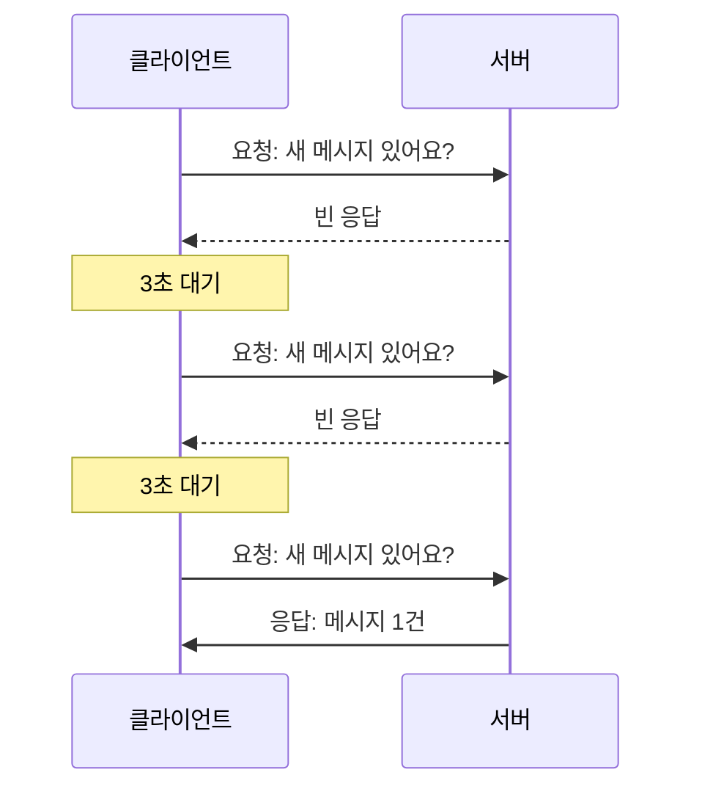
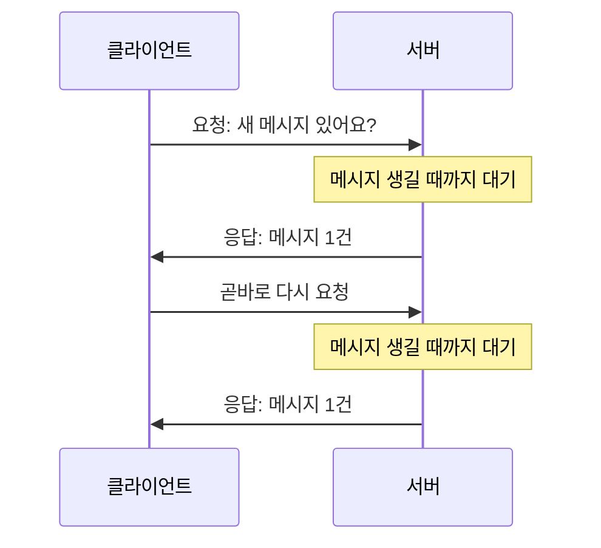
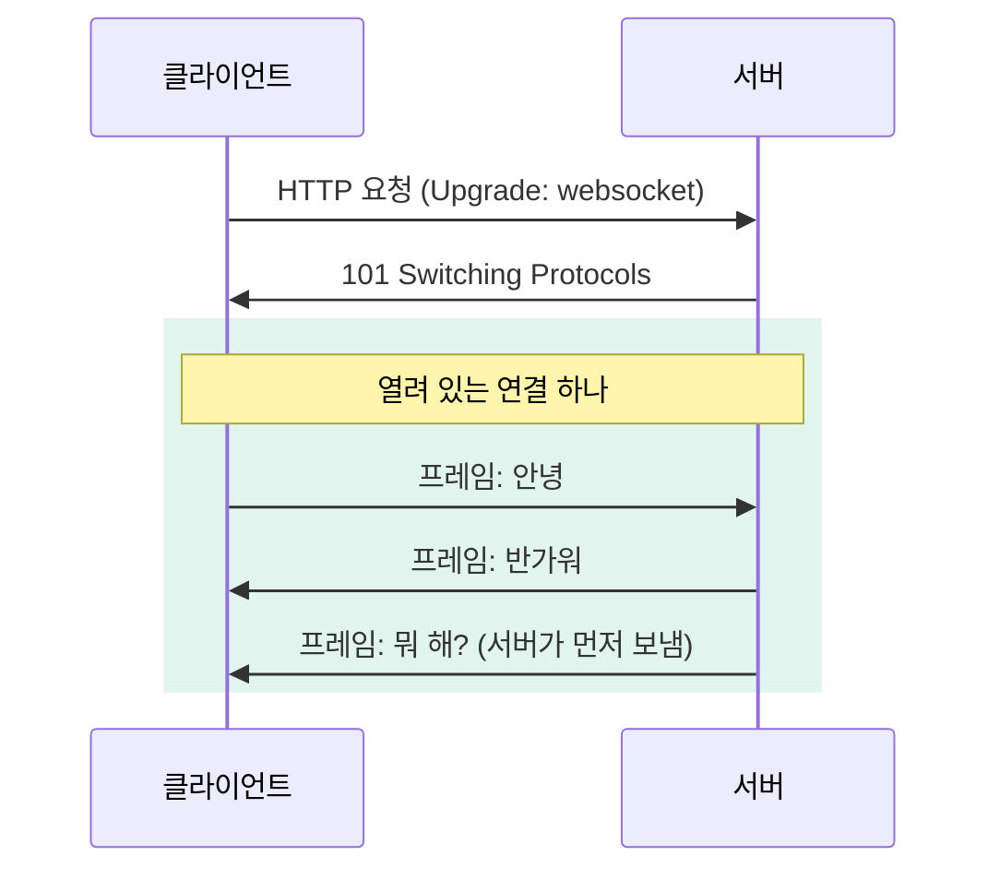
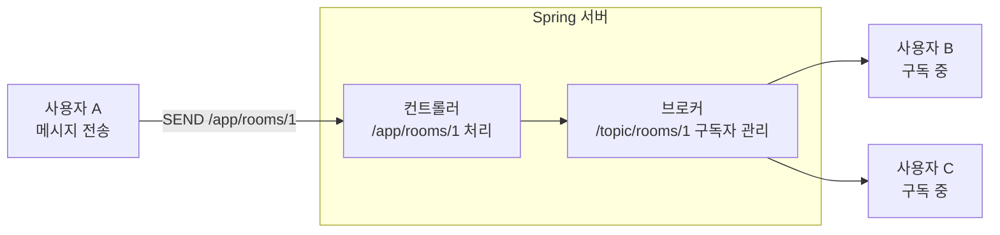
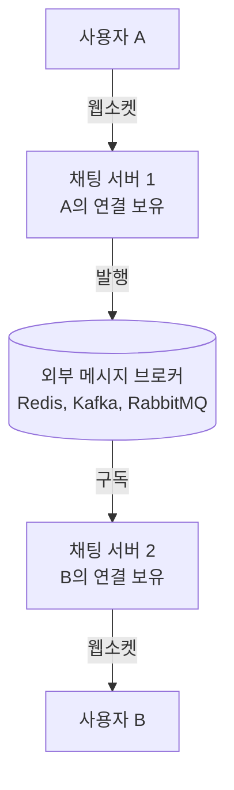
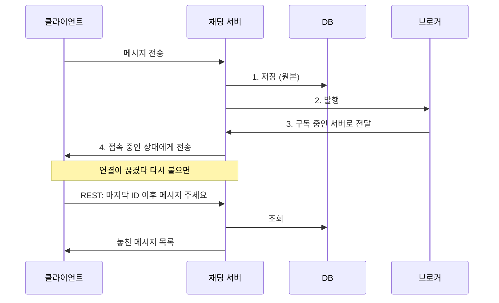
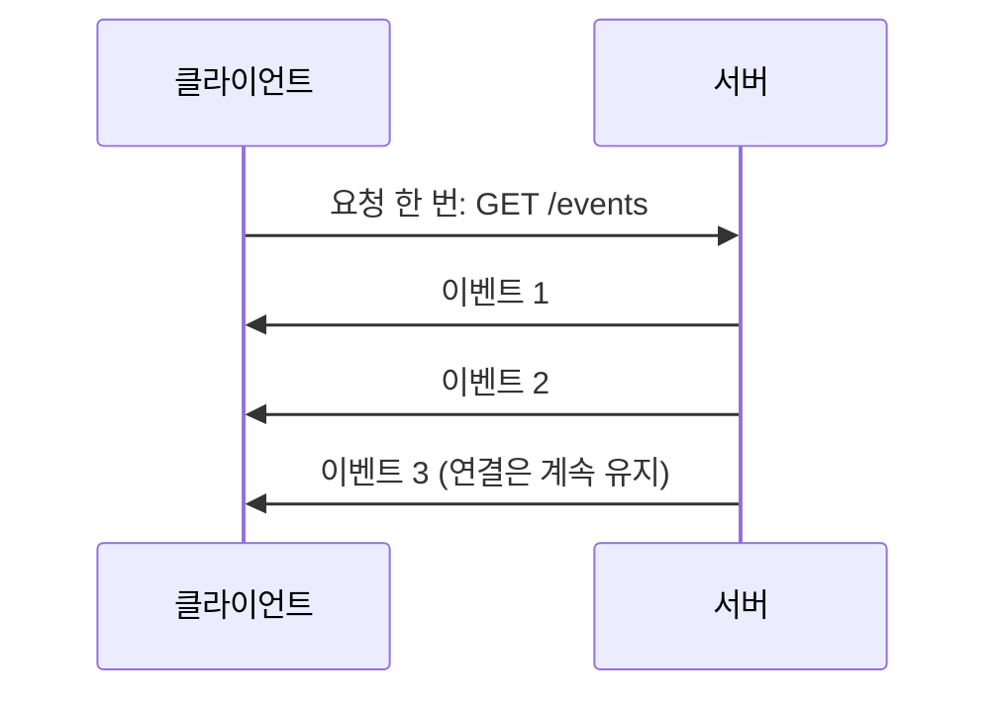

# 백엔드 채팅 딥다이브

## 목차

1. [탄생 배경 — 왜 생겼는가](#1-탄생-배경--왜-생겼는가)
2. [핵심 원리 — 어떻게 동작하는가](#2-핵심-원리--어떻게-동작하는가)
3. [사용법 — 어떻게 쓰는가](#3-사용법--어떻게-쓰는가)
4. [진화 과정 — 어떻게 바뀌어 왔는가](#4-진화-과정--어떻게-바뀌어-왔는가)
5. [응용과 실무 — 현업에서는 어떻게 쓰는가](#5-응용과-실무--현업에서는-어떻게-쓰는가)
6. [대안과 트레이드오프](#6-대안과-트레이드오프)
7. [마무리](#마무리)
8. [출처](#출처)

---

## 1. 탄생 배경 — 왜 생겼는가

### 해당 주제를 학습하게 된 이유

채팅 기능이 필요해서 공부를 시작했다. 처음에는 기능을 붙이는 방법만 알면 될 줄 알았는데, 동작 방식을 이해하려고 하나씩 따라가다 보니 "왜 이렇게 생겼는가"까지 거슬러 올라가게 됐다. 이 문서는 그 과정을 처음부터 순서대로 정리한 것이다.

### 문제: HTTP에서는 서버가 먼저 말을 걸 수 없다

HTTP는 클라이언트가 요청해야만 서버가 응답한다. 채팅에서는 상대가 메시지를 보낸 순간 서버가 내게 먼저 알려줘야 하는데, 그럴 방법이 없었다. 그래서 두 가지 우회로가 쓰였다.

### 첫 번째 우회: 폴링 (polling)

클라이언트가 정해진 주기로 "새 메시지 있어요?"를 묻는다. 서버는 있든 없든 바로 답한다.

```javascript
setInterval(async () => {
  const res = await fetch(`/api/messages?after=${lastId}`);
  render(await res.json());   // 대부분은 빈 배열
}, 3000);
```



- 대부분의 응답은 비어 있다. 아무도 말하지 않아도 요청은 계속 나간다.
- 메시지는 다음 질문 차례가 올 때까지 기다려야 하므로 주기만큼 늦게 도착한다.
- 주기를 줄이면 빈 요청이 폭증한다. 접속자가 1만 명이면 조용한 상태에서도 초당 수천 건이 들어온다.

### 두 번째 우회: 롱 폴링 (long polling)과 Comet

폴링의 "빈 응답"을 없앤 방식이다. 서버가 요청을 받고도 바로 답하지 않고, 새 메시지가 생길 때까지 응답을 붙잡아 둔다. 이런 기법을 묶어 Comet이라고 불렀고, 이 이름은 2006년 Alex Russell이 붙였다. Gmail Chat, Meebo 등이 이 방식으로 유명했다.



지연은 줄었지만 고통은 남았다.

- 메시지 하나마다 양방향 모두 온전한 HTTP 요청이 필요했고, 쿠키가 붙으면 헤더만 수 킬로바이트였다. "ㅋㅋ" 두 글자에 헤더 수 KB가 따라붙는 셈이다.
- 서버는 아무 일도 하지 않는 요청 수천 개를 붙든 채 버텨야 했다.
- HTTP를 속여 쓰는 방식이라 구현이 복잡하고 프록시 환경에서 자주 깨졌다.

### 등장: WebSocket

| 시점 | 사건 |
|---|---|
| 2008년 | HTML5 명세 편집자 Ian Hickson과 Michael Carter가 제안. 처음 이름은 TCPConnection이었고 #whatwg IRC 논의에서 WebSocket으로 바뀜 |
| 2009년 12월 | Chrome이 기본 활성화 상태로 가장 먼저 지원 |
| 2010년 2월 | 프로토콜 작업이 IETF로 이관 |
| 2011년 12월 | RFC 6455로 표준 확정 (저자 I. Fette, A. Melnikov) |

### 핵심 아이디어 한 줄

HTTP로 문을 연 뒤에는 TCP 연결 하나를 계속 열어두고, 양쪽이 아무 때나 말한다.

---

## 2. 핵심 원리 — 어떻게 동작하는가



### ① 핸드셰이크 (handshake): HTTP로 시작해서 갈아탄다

새 포트를 뚫지 않고 평범한 HTTP 요청으로 시작한다. 기존 방화벽과 프록시를 그대로 통과하기 위해서다.

```
GET /chat HTTP/1.1
Upgrade: websocket
Connection: Upgrade
        ↓
HTTP/1.1 101 Switching Protocols
```

클라이언트가 Upgrade 헤더를 보내고 서버가 101로 답하면, 그 순간부터 같은 TCP 연결은 더 이상 HTTP가 아니다.

### ② 프레임 (frame): 헤더 다이어트

연결이 열린 뒤에는 몇 바이트짜리 헤더만 붙은 작은 단위로 메시지를 보낸다. 1단계의 "헤더 수 KB" 문제가 여기서 풀린다.

### ③ 전이중 (full-duplex) 지속 연결: 서버가 상태를 갖게 된다

양쪽이 동시에, 아무 때나 보낼 수 있다. 백엔드 개발자에게 가장 중요한 결과는 **서버가 상태를 갖게 된다(stateful)** 는 점이다.

- HTTP API 서버는 요청이 끝나면 클라이언트를 잊어도 된다.
- 웹소켓 서버는 "지금 누가 나와 연결돼 있는가"를 메모리에 계속 들고 있어야 한다.

서버가 2대가 되면 서버 1은 서버 2에 붙은 사용자를 모른다. 채팅 백엔드에 메시지 브로커(message broker)가 등장하는 이유다. (5단계에서 다룬다.)

### ④ 서브프로토콜 (subprotocol): 웹소켓은 "파이프"일 뿐이다

웹소켓은 바이트를 실어 나를 뿐, 채팅방·구독·수신자 같은 개념이 없다. 그 위에 얹을 애플리케이션 규약은 `Sec-WebSocket-Protocol` 헤더로 협상한다. Spring에서는 이 자리에 STOMP를 쓴다. STOMP는 "어디를 구독(SUBSCRIBE)하고 어디로 보낸다(SEND)"는 의미를 부여한다.



### ⑤ 하트비트 (heartbeat): 죽은 연결 찾아내기

연결을 오래 열어두면 지하철 터널이나 와이파이 전환처럼 "끊겼는데 양쪽 다 모르는" 상태가 생긴다. 주기적으로 신호(ping/pong)를 주고받아 살아 있는지 확인한다.

### 비유와 그 한계

폴링은 "편지 왔나요?" 하고 우체국에 계속 가보는 것이고, 웹소켓은 전화를 걸어놓고 끊지 않는 것이다.

실제와 어긋나는 지점:

- 전화는 끊기면 바로 알지만 웹소켓은 모를 수 있다. 그래서 ⑤가 필요하다.
- 통화 중에 놓친 말은 누구도 다시 들려주지 않는다. 웹소켓에는 전달 보장이나 재전송이 없어서, 메시지 저장과 재접속 복구는 직접 설계해야 한다.

---

## 3. 사용법 — 어떻게 쓰는가

Spring Boot + STOMP 기준 최소 예제. 아래 설정 API는 Spring 4부터 이어진 것이지만, 쓰는 버전의 공식 문서로 한 번 확인할 것.

### 의존성

```groovy
implementation 'org.springframework.boot:spring-boot-starter-websocket'
```

### 설정

```java
@Configuration
@EnableWebSocketMessageBroker
public class WebSocketConfig implements WebSocketMessageBrokerConfigurer {

    @Override
    public void registerStompEndpoints(StompEndpointRegistry registry) {
        registry.addEndpoint("/ws")                              // ① 핸드셰이크 URL
                .setAllowedOriginPatterns("http://localhost:3000");
    }

    @Override
    public void configureMessageBroker(MessageBrokerRegistry registry) {
        registry.setApplicationDestinationPrefixes("/app");      // ④ 컨트롤러로 가는 메시지
        registry.enableSimpleBroker("/topic");                   // ③ 구독자 목록을 메모리에 보관
    }
}
```

### 컨트롤러

```java
public record ChatMessage(String sender, String content) {}

@Controller
public class ChatController {

    @MessageMapping("/rooms/{roomId}")        // 클라이언트가 /app/rooms/1 로 SEND
    @SendTo("/topic/rooms/{roomId}")          // /topic/rooms/1 구독자 전원에게 전달
    public ChatMessage send(@DestinationVariable String roomId, ChatMessage message) {
        return message;
    }
}
```

### 클라이언트

Spring 공식 문서가 브라우저용으로 안내하는 `stomp-js/stompjs` 사용.

```javascript
import { Client } from '@stomp/stompjs';

const client = new Client({ brokerURL: 'ws://localhost:8080/ws' });   // ① 핸드셰이크
client.onConnect = () => {
  client.subscribe('/topic/rooms/1', (frame) =>                       // ④ SUBSCRIBE
    console.log(JSON.parse(frame.body)));
  client.publish({                                                    // ④ SEND
    destination: '/app/rooms/1',
    body: JSON.stringify({ sender: 'kim', content: '안녕' }),
  });
};
client.activate();
```

### 개념과의 연결

- `/ws`는 ①의 핸드셰이크가 일어나는 주소다.
- `/app`과 `/topic`은 ④의 STOMP가 부여한 의미다. `/app`은 서버 로직으로, `/topic`은 구독자에게 간다.
- `enableSimpleBroker`는 ③의 "서버가 든 상태"다. 메모리에 있으므로 서버 1대에서만 통한다.

### 처음 쓰는 사람이 자주 하는 실수

1. **보낸 사람을 본문에서 읽는다.** 위 예제처럼 `sender`를 클라이언트가 보낸 값 그대로 믿으면 누구나 남을 사칭할 수 있다. 연결 시점(STOMP CONNECT)에 인증하고, 컨트롤러에서는 `Principal`에서 사용자를 꺼내야 한다.
2. **저장 없이 뿌리기만 한다.** `@SendTo`만 쓰면 그 순간 접속 중인 사람만 받는다. 먼저 DB에 저장하고 그다음에 전달해야 나중에 들어온 사람이 이전 대화를 볼 수 있다.

---

## 4. 진화 과정 — 어떻게 바뀌어 왔는가

### 프로토콜의 진화

| 시기 | 드러난 한계 | 바뀐 것 |
|---|---|---|
| 2011 | 표준은 나왔지만 구형 브라우저와 프록시가 웹소켓을 막음 | SockJS·Socket.IO 같은 폴백(fallback) 라이브러리 |
| 2013 | 웹소켓은 파이프일 뿐이라 메시지 라우팅을 매번 직접 구현 | Spring 4가 웹소켓 + SockJS + STOMP 지원 추가 |
| 2015 | 텍스트를 그대로 보내 대역폭 낭비 | RFC 7692, 메시지 단위 압축(permessage-deflate) |
| 2018 | HTTP/2에서는 핸드셰이크가 동작하지 않음 | RFC 8441, 확장 CONNECT 방식 |
| 2022 | HTTP/3에도 같은 문제 | RFC 9220 |
| 2026 | TCP 기반이라 패킷 하나가 막히면 뒤 메시지도 전부 대기, 네트워크 전환 시 연결 끊김 | WebTransport가 전 브라우저 지원에 도달 |

- **2013년, Spring 4.** 첫 마일스톤에서 SockJS 서버 지원을, 2013년 7월 두 번째 마일스톤에서 웹소켓 위 상위 메시징 프로토콜 지원을 넣었다. 지금 Spring 채팅 예제가 대부분 STOMP인 이유가 여기서 시작된다.
- **2018년, HTTP/2.** HTTP/2에는 Upgrade 헤더도 101 상태 코드도 없어서, 확장 CONNECT 메서드로 스트림 하나에 웹소켓 터널을 연다. TCP 연결 하나를 일반 HTTP/2 트래픽과 웹소켓이 함께 쓴다. 2단계 ①의 핸드셰이크는 HTTP/1.1 기준이라는 뜻이다.
- **2026년, WebTransport.** Chrome·Edge(97부터)와 Firefox(114부터)에만 있다가, 2026년 3월 Safari 26.4가 기본 탑재하면서 Baseline이 됐다. HTTP/3(QUIC) 위에서 신뢰성 있는 양방향 스트림과 비신뢰 데이터그램을 한 API로 제공한다.

### 채팅 서버 구조의 진화

> 이 부분은 특정 문서가 아니라 업계에서 일반적으로 알려진 흐름을 정리한 것이다.

1. **서버 1대 + 메모리.** 접속자 목록을 `Map`에 들고 직접 뿌린다. 서버가 2대가 되는 순간 깨진다.
2. **외부 브로커 도입.** Spring 내장 simple broker는 인스턴스 하나에서만 통하므로, 여러 대에서는 RabbitMQ·ActiveMQ로 STOMP 메시지를 넘기는 broker relay가 필요하다. Redis Pub/Sub도 같은 자리에 쓰인다.
3. **영속 로그 도입.** Redis Pub/Sub은 그 순간 구독 중이 아니면 메시지가 사라진다. 유실이 치명적이면 Kafka처럼 디스크에 남기는 브로커로 간다.
4. **연결 서버와 로직 서버 분리.** 연결만 붙드는 게이트웨이와 메시지를 처리·저장하는 서버를 나눈다. 배포 때마다 전원의 연결이 끊기는 문제를 줄인다.

### 옛 자료에서 헷갈리기 쉬운 것

- **`withSockJS()`와 `new SockJS(...)`.** 웹소켓이 안 되는 브라우저용 폴백이다. 지금은 모든 현대 브라우저가 웹소켓을 기본 지원한다. Spring은 여전히 옵션으로 제공하지만, 프록시가 웹소켓을 막는 사내망 같은 환경이 아니면 새 프로젝트에서는 빼도 된다.
- **`Stomp.over(socket)` (옛 stomp.js).** 2013년 무렵 예제의 클라이언트 코드다. 지금은 `@stomp/stompjs`를 쓴다.
- **Flash 소켓, 숨은 iframe 스트리밍.** Comet 시절 기법으로 지금은 쓰지 않는다.

### 현재 권장 방식과 방향

- **채팅은 여전히 웹소켓이다.** WebTransport는 브라우저 쪽은 준비됐지만 서버 생태계가 아직 비어 있어서, 채팅 기능이라면 웹소켓이나 SSE를 그대로 쓰라는 평가가 나온다.
- **Spring 기준 기본 조합은 `wss://` + 네이티브 웹소켓 + STOMP다.** 서버가 여러 대면 외부 브로커를 붙인다.
- **SSE가 다시 주목받고 있다.** 알림이나 AI 답변 스트리밍처럼 서버에서 클라이언트로만 보내는 경우에 쓴다. (검색 확인이 아닌 일반적 경향)

---

## 5. 응용과 실무 — 현업에서는 어떻게 쓰는가

> 이 단계는 일반적으로 통용되는 실무 지식을 정리한 것이고, 수치는 서비스마다 다르다.

### 서버가 여러 대일 때: 외부 메시지 브로커

3단계 예제의 브로커는 서버 메모리 안에 있다. 서버가 2대가 되면 A는 서버 1에, B는 서버 2에 붙을 수 있고, 서버 1의 브로커는 B를 모른다. 그래서 브로커를 서버 밖으로 꺼낸다.



- 서버 1은 받은 메시지를 외부 브로커에 발행한다.
- 모든 서버가 그 브로커를 구독하고 있다가, 자기에게 연결된 사용자에게 전달한다.

### 흔한 패턴

- **저장 후 전달.** 메시지를 DB에 먼저 쓰고, 그다음 브로커로 발행한다. 웹소켓은 "지금 접속한 사람에게 빨리 알리는" 용도이고, 진실의 원본은 DB다.
- **재접속 복구.** 클라이언트가 마지막으로 받은 메시지 ID를 기억했다가, 다시 붙으면 REST로 "그 이후 메시지"를 받아온다. 2단계 비유의 "놓친 말" 문제를 이렇게 푼다.
- **오프라인 사용자.** 연결이 없는 사용자에게는 FCM·APNs 같은 푸시 알림으로 보낸다.
- **읽음 처리와 안 읽은 수.** 메시지마다 읽음 여부를 저장하지 않고, 사용자별로 "이 방에서 어디까지 읽었나"만 저장하는 방식이 흔하다.



### 운영하면서 만나는 문제

| 문제 | 원인 | 대응 |
|---|---|---|
| 순서 뒤바뀜 | 서버 여러 대의 시계가 서로 다름 | 시간 대신 방 단위로 증가하는 번호를 서버가 부여 |
| 중복 수신 | 재전송 | 클라이언트가 만든 고유 ID로 중복 제거 |
| 재접속 폭주 | 서버 한 대가 죽으면 전원이 동시에 다시 붙음 | 클라이언트 재시도에 무작위 지연(jitter) |
| 느린 수신자 | 받는 쪽 네트워크가 느려 서버 전송 버퍼에 적체 | 버퍼 한도와 초과 시 연결 종료 정책 |
| 유휴 연결 끊김 | 로드밸런서가 조용한 연결을 끊음 | 하트비트 주기를 LB 유휴 타임아웃보다 짧게 |

- **보안.** 핸드셰이크에서 Origin을 검사하고, 구독 시점마다 "이 사용자가 이 방 멤버인가"를 확인한다. 메시지 크기와 전송 빈도에도 제한을 둔다.
- **모니터링.** 서버별 동시 연결 수, 메시지 전달 지연, 재접속 빈도, 브로커 적체량을 본다.

### 쓰지 말아야 할 상황

- 서버에서 클라이언트로만 가는 알림이면 SSE가 더 단순하다.
- 몇 분에 한 번 바뀌는 데이터면 폴링으로 충분하다. 지속 연결은 서버 자원을 계속 점유한다.

---

## 6. 대안과 트레이드오프

### SSE (Server-Sent Events)

웹소켓의 "반쪽"이다. 요청 한 번으로 연결을 열어두고, 서버만 계속 흘려보낸다.



- 평범한 HTTP 응답을 끝내지 않고 이어 쓰는 방식이라 구현이 단순하다.
- 클라이언트가 보낼 때는 일반 HTTP 요청을 따로 쓴다.

### 전송 방식 비교

| 기술 | 방향 | 고르는 조건 |
|---|---|---|
| WebSocket | 양방향 | 채팅처럼 양쪽이 자주 주고받을 때 |
| SSE | 서버→클라이언트 | 알림, 피드, 스트리밍 응답. 보내는 건 일반 HTTP 요청으로 충분할 때 |
| 롱 폴링 | 흉내 낸 양방향 | 웹소켓이 막힌 네트워크의 폴백 |
| WebTransport | 양방향 + 비신뢰 전송 | 게임·실시간 미디어처럼 일부 유실을 감수하고 지연을 줄일 때 |

### STOMP vs 순수 웹소켓 핸들러

- **STOMP.** 구독·라우팅이 이미 만들어져 있고 외부 브로커 연동이 쉽다. 방 단위 채팅을 빨리 만들 때 고른다.
- **순수 `WebSocketHandler`.** 프레임을 직접 다루므로 자유롭지만 라우팅을 직접 짜야 한다. 메시지 형식을 완전히 통제해야 하거나 클라이언트가 STOMP를 못 쓸 때 고른다.

### 브로커 선택

- **Redis Pub/Sub.** 가장 단순하고 빠르다. 유실을 DB 재조회로 메울 수 있으면 충분하다.
- **RabbitMQ.** STOMP를 직접 지원해서 Spring의 broker relay와 바로 붙는다.
- **Kafka.** 메시지를 디스크에 남기고 다시 읽을 수 있다. 채팅 메시지를 검색·통계·알림 등 다른 시스템에도 흘려야 하거나 유실이 허용되지 않는 규모에서 고른다. 운영 부담이 가장 크다.

**판단 순서**

1. 서버 1대면 브로커가 필요 없다.
2. 2대 이상이고 DB가 원본이면 Redis로 시작한다.
3. 메시지 흐름 자체를 여러 시스템이 소비해야 하면 Kafka로 간다.

---

## 마무리

### 요약

HTTP는 서버가 먼저 말할 수 없어서 폴링과 롱 폴링으로 버텼고, 그 낭비와 복잡함을 없애려고 2011년 웹소켓이 표준이 됐다. 웹소켓은 연결 하나를 열어두고 양방향으로 작은 프레임을 주고받는다. 그 대가로 서버가 연결 상태를 갖게 되어, 서버가 여러 대면 메시지 브로커가 필요하다. 지금 실무는 "DB에 저장하고, 브로커로 퍼뜨리고, 웹소켓으로 알린다"는 구조에 재접속 복구와 푸시 알림을 더한 형태다.

### 한 줄로 잇는 흐름

- **폴링 → 롱 폴링:** 빈 응답이 낭비라서 서버가 응답을 붙잡게 됐다.
- **롱 폴링 → 웹소켓:** 그래도 메시지마다 HTTP 한 쌍이 필요해서, 연결 하나를 열어두게 됐다.
- **웹소켓 → STOMP:** 웹소켓에는 "방" 개념이 없어서 구독과 라우팅을 얹었다.
- **내장 브로커 → 외부 브로커:** 브로커가 서버 메모리에 있으면 서버 1대에서만 통해서 밖으로 꺼냈다.
- **SSE:** 서버만 말하면 되는 경우의 더 단순한 선택지.

### 다음에 파볼 주제

- Redis Pub/Sub과 Redis Streams: 왜 Pub/Sub은 유실되고 Streams는 남는가
- Kafka: 파티션과 순서 보장이 채팅방 단위 순서와 어떻게 맞물리는가
- Spring Security의 웹소켓 인증: STOMP CONNECT에서 JWT 검증하기

---

## 출처

- [RFC 6455: The WebSocket Protocol](https://www.rfc-editor.org/info/rfc6455)
- [RFC 6455 발행 공지 (IETF)](https://mailarchive.ietf.org/arch/msg/ietf-announce/7dYVwa6pABzztQO4gTIHx3MYRGo/)
- [RFC 8441: Bootstrapping WebSockets with HTTP/2](https://conference.greenbytes.de/tech/specs/rfc8441.html)
- [RFC 9220: Bootstrapping WebSockets with HTTP/3](https://datatracker.ietf.org/doc/rfc9220/)
- [WebSocket 프로토콜 개요 (http.dev)](https://http.dev:443/ws)
- [WebSocket standards (websocket.org)](https://websocket.org/standards/)
- [The history of WebSockets (Ably)](https://ably.com/topic/websockets-history)
- [History of WebSockets (Taskade)](https://www.taskade.com/blog/websockets-history.md)
- [WebSocket (Wikipedia)](https://www.wikipedia.org/wiki/WebSocket)
- [A short historic overview: server events in real-time](https://hn.jakechampion.name/reader/https://www.markusdosch.com/2020/05/a-short-historic-overview-building-javascript-apps-that-receive-server-events-in-real-time)
- [Spring Framework 4.0 M2: WebSocket Messaging Architectures](https://spring.io/blog/2013/07/24/spring-framework-4-0-m2-websocket-messaging-architectures)
- [Spring Framework 레퍼런스: Enable STOMP](https://docs.spring.io/spring/reference/web/websocket/stomp/enable.html)
- [Spring Boot WebSocket 가이드 (websocket.org)](https://websocket.org/guides/frameworks/spring-boot/)
- [MDN: WebTransport API](https://developer.mozilla.org/docs/Web/API/WebTransport_API)
- [WebTransport Baseline 정리 (Fora Soft)](https://www.forasoft.com/learn/video-streaming/articles-streaming/webtransport-whip)
- [Frontier Web APIs in 2026 (Utsubo)](https://www.utsubo.com/blog/frontier-web-apis-2026-production-ready)
- [WebTransport explained (CoderCops)](https://blog.codercops.com/blog/webtransport-explained-websocket-alternative-2026)
