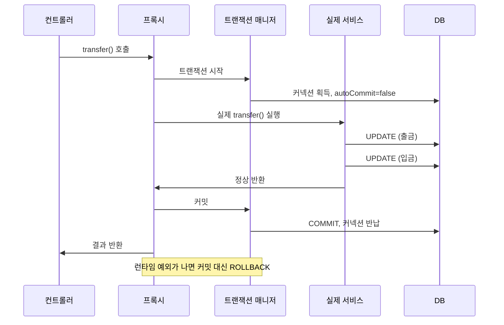
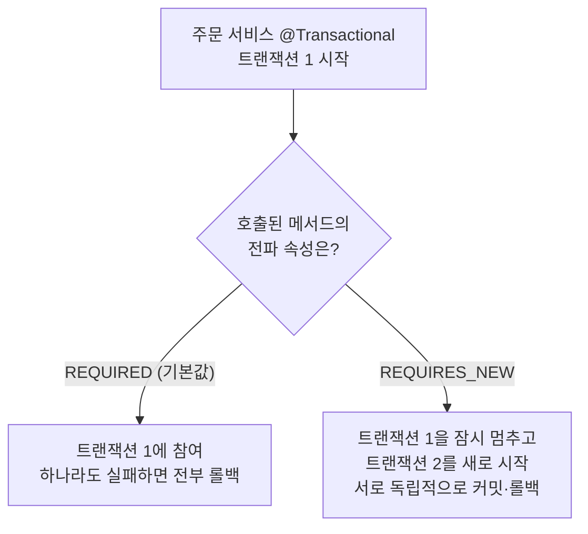
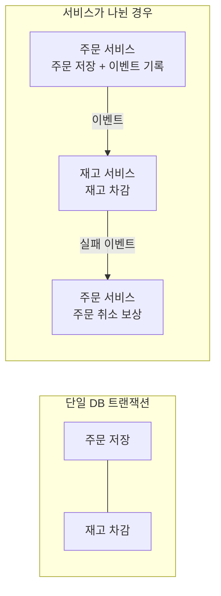

# 트랜잭션과 @Transactional 딥다이브

> 탄생 배경 → 핵심 원리 → 사용법 → 진화 과정 → 응용과 실무 → 대안과 트레이드오프 순서로 정리한 학습 노트.
> 그림은 Mermaid로 작성했다. 작성일: 2026-11-14
>
> **주의:** 이 문서의 Spring 버전별 연도(4단계)는 Spring 1.0 출시(2004년 3월)를 제외하고 검색으로 확인하지 못한 기억 기준이다. 인용하기 전에 공식 문서로 확인할 것.

---

## 1. 탄생 배경 — 왜 생겼는가

### 내가 이 주제를 파게 된 이유

> (직접 채워 넣기: 어떤 상황에서 트랜잭션을 고민하게 됐고, 무엇이 궁금했는지)

### 문제: "전부 성공하거나, 전부 없던 일이거나"

계좌 이체는 두 단계다. A 계좌에서 빼고, B 계좌에 더한다. 첫 단계만 실행되고 서버가 죽으면 돈이 사라진다. 이 둘을 **하나의 작업 단위**로 묶는 것이 트랜잭션(transaction)이다. 데이터베이스는 1970년대부터 이 기능을 제공해 왔다.

문제는 DB가 아니라 **애플리케이션 코드에서 트랜잭션을 다루는 방식**이었다.

### 이전에는 어떻게 했나: JDBC로 직접

```java
public void transfer(Long fromId, Long toId, long amount) throws SQLException {
    Connection con = dataSource.getConnection();
    try {
        con.setAutoCommit(false);                    // 트랜잭션 시작
        accountDao.withdraw(con, fromId, amount);    // 커넥션을 계속 넘겨야 함
        accountDao.deposit(con, toId, amount);
        con.commit();                                // 성공하면 커밋
    } catch (Exception e) {
        con.rollback();                              // 실패하면 롤백
        throw e;
    } finally {
        con.close();
    }
}
```

### 구체적인 고통

- **비즈니스 로직이 묻힌다.** 진짜 로직은 두 줄인데 트랜잭션 처리 코드가 열 줄이다. 모든 서비스 메서드에 같은 틀이 반복된다.
- **커넥션을 들고 다녀야 한다.** 같은 트랜잭션이려면 같은 커넥션을 써야 하므로, 모든 DAO 메서드에 `Connection`을 인자로 넘겼다.
- **기술에 종속된다.** JDBC, Hibernate, JTA(여러 자원에 걸친 트랜잭션)의 트랜잭션 API가 전부 달랐다. 기술을 바꾸면 서비스 코드를 다 고쳐야 했다.
- **EJB의 선언적 트랜잭션은 있었지만 무거웠다.** 설정만으로 트랜잭션을 걸 수 있었지만, 무거운 EJB 컨테이너가 필요했다.

### 누가, 언제 만들었나

- Rod Johnson이 2002년 저서에서 EJB 없이 엔터프라이즈 애플리케이션을 만드는 방식을 제안했고, 이것이 Spring Framework의 출발점이 됐다. (기억 기준)
- Spring 1.0은 2004년 3월에 출시됐다. 트랜잭션 추상화(`PlatformTransactionManager`)와 선언적 트랜잭션은 초기부터 핵심 기능이었다. (기억 기준)
- `@Transactional` 어노테이션은 Java 5 어노테이션이 나온 뒤 Spring 1.2에서 추가됐다. (기억 기준)

### 핵심 아이디어 한 줄

트랜잭션의 시작과 끝을 코드에 쓰지 않고, 메서드에 "이건 트랜잭션이다"라고 **선언**만 한다. 실제 처리는 프록시가 대신한다.

---

## 2. 핵심 원리 — 어떻게 동작하는가

### ① ACID: 트랜잭션이 보장하는 네 가지

| 성질 | 의미 | 이체 예시 |
|---|---|---|
| 원자성 (Atomicity) | 전부 반영되거나 전부 취소된다 | 출금만 되고 입금이 안 되는 일은 없다 |
| 일관성 (Consistency) | 제약 조건을 깨지 않는다 | 잔액이 음수가 되지 않는다 |
| 격리성 (Isolation) | 동시에 실행되는 트랜잭션이 서로 간섭하지 않는다 | 이체 도중의 중간 상태를 남이 보지 못한다 |
| 지속성 (Durability) | 커밋된 것은 장애가 나도 남는다 | 커밋 직후 서버가 죽어도 이체는 유효하다 |

### ② 격리 수준 (isolation level): 격리성과 성능의 교환

완벽한 격리는 느리다. 그래서 DB는 "어디까지 허용할지"를 단계로 제공한다.

| 격리 수준 | 더티 리드 | 반복 불가능 읽기 | 팬텀 리드 |
|---|---|---|---|
| READ UNCOMMITTED | 발생 | 발생 | 발생 |
| READ COMMITTED | 방지 | 발생 | 발생 |
| REPEATABLE READ | 방지 | 방지 | 발생 가능 |
| SERIALIZABLE | 방지 | 방지 | 방지 |

- **더티 리드:** 남이 아직 커밋하지 않은 값을 읽는다.
- **반복 불가능 읽기:** 같은 행을 두 번 읽었는데 그 사이 남이 수정·커밋해서 값이 다르다.
- **팬텀 리드:** 같은 조건으로 두 번 조회했는데 그 사이 남이 행을 추가해서 결과 건수가 다르다.

기본값은 DB마다 다르다. MySQL(InnoDB)은 REPEATABLE READ, PostgreSQL과 Oracle은 READ COMMITTED다.

### ③ 트랜잭션 매니저 (PlatformTransactionManager): 기술 차이를 숨긴다

JDBC든 JPA든 "시작, 커밋, 롤백"이라는 같은 인터페이스로 다룬다. 그리고 **커넥션을 스레드에 묶어 둔다.** 그래서 DAO에 커넥션을 넘기지 않아도, 같은 스레드에서 실행되는 코드는 자동으로 같은 커넥션(같은 트랜잭션)을 쓴다.

### ④ AOP 프록시: 선언이 동작으로 바뀌는 곳

`@Transactional`이 붙은 빈을 주입받으면, 실제 객체가 아니라 **그 객체를 감싼 프록시**가 들어온다. 프록시가 메서드 호출을 가로채서 앞뒤로 트랜잭션을 처리한다.



1단계의 JDBC 코드에서 `try-catch-finally`가 하던 일을 프록시가 그대로 대신한다.

### ⑤ 전파 (propagation): 트랜잭션 안에서 또 트랜잭션 메서드를 부르면



- **REQUIRED:** 이미 트랜잭션이 있으면 참여하고, 없으면 새로 시작한다. 대부분 이것이다.
- **REQUIRES_NEW:** 항상 새 트랜잭션을 연다. "주문이 실패해도 실패 이력은 남겨야 한다" 같은 경우에 쓴다.

### 비유와 그 한계

트랜잭션은 "연필로 쓴 뒤 마지막에 볼펜으로 덧쓰는 것"과 같다. 커밋 전까지는 언제든 지울 수 있고(롤백), 커밋하면 확정된다.

어긋나는 지점: 롤백되는 것은 **DB 변경뿐**이다. 트랜잭션 안에서 보낸 이메일, 호출한 외부 결제 API, 발행한 메시지는 롤백되지 않는다.

---

## 3. 사용법 — 어떻게 쓰는가

### 기본 사용

```java
@Service
@RequiredArgsConstructor
public class TransferService {

    private final AccountRepository accountRepository;

    @Transactional                                      // ④ 프록시가 앞뒤로 트랜잭션 처리
    public void transfer(Long fromId, Long toId, long amount) {
        Account from = accountRepository.findById(fromId).orElseThrow();
        Account to = accountRepository.findById(toId).orElseThrow();
        from.withdraw(amount);                          // 예외가 나면 전체 롤백 (① 원자성)
        to.deposit(amount);
    }

    @Transactional(readOnly = true)                     // 조회 전용
    public long balance(Long id) {
        return accountRepository.findById(id).orElseThrow().getBalance();
    }
}
```

1단계의 JDBC 코드와 비교하면, 커넥션도 `commit`도 `rollback`도 보이지 않는다. 비즈니스 로직만 남았다.

### 옵션

```java
@Transactional(
    isolation = Isolation.READ_COMMITTED,      // ② 격리 수준
    propagation = Propagation.REQUIRES_NEW,    // ⑤ 전파
    timeout = 5,                               // 초 단위
    rollbackFor = Exception.class              // 체크 예외에도 롤백
)
```

### 처음 쓰는 사람이 자주 하는 실수

**1. 같은 클래스 안에서 호출 (self-invocation)**

```java
public void outer() {
    inner();              // this.inner() — 프록시를 거치지 않음
}

@Transactional
public void inner() { ... }   // 트랜잭션이 걸리지 않는다
```

④에서 본 것처럼 트랜잭션은 프록시가 건다. 같은 객체 안에서 부르면 프록시를 거치지 않으므로 `@Transactional`이 무시된다. 메서드를 다른 빈으로 분리해야 한다.

**2. 체크 예외는 롤백되지 않는다.** 기본 규칙은 "런타임 예외(`RuntimeException`)와 `Error`만 롤백"이다. `IOException` 같은 체크 예외가 나면 **커밋된다.** 롤백하려면 `rollbackFor`를 지정한다.

**3. 예외를 잡아서 삼킨다.** 안쪽 메서드(REQUIRED로 참여)에서 예외가 나면 트랜잭션에 "롤백 전용" 표시가 찍힌다. 바깥에서 그 예외를 `try-catch`로 잡고 정상 종료하면, 커밋 시점에 `UnexpectedRollbackException`이 난다.

**4. `private` 메서드에 붙인다.** 프록시가 가로챌 수 없어서 동작하지 않는다.

---

## 4. 진화 과정 — 어떻게 바뀌어 왔는가

> 이 표의 연도와 버전은 Spring 1.0(2004년 3월)을 제외하고 기억 기준이다.

| 단계 | 드러난 한계 → 바뀐 것 |
|---|---|
| JDBC 직접 제어 | 반복 코드, 커넥션 전달, 기술 종속 |
| EJB 컨테이너 관리 트랜잭션 | 선언만으로 가능해졌지만 무거운 컨테이너 필요 |
| Spring 1.0 (2004) | EJB 없이 선언적 트랜잭션. 다만 XML에 프록시 설정을 길게 써야 했다 |
| Spring 1.2 (2005 무렵) | XML 설정의 장황함 → `@Transactional` 어노테이션 |
| Spring 2.0 (2006 무렵) | 프록시 빈을 일일이 정의 → `<tx:annotation-driven/>` 한 줄 |
| Spring Boot (2014~) | 트랜잭션 매니저 빈을 직접 등록 → 자동 설정. 의존성만 있으면 `@Transactional`이 바로 동작 |
| Spring 5.2 (2019 무렵) | 스레드에 커넥션을 묶는 방식은 리액티브에서 동작하지 않음 → 리액티브 트랜잭션 매니저 |
| 최근 | 단일 DB 트랜잭션으로는 마이크로서비스 간 일관성을 못 지킴 → 아웃박스, 사가 패턴이 표준 해법으로 자리 잡음 |

### 옛 자료에서 헷갈리기 쉬운 것

- **`TransactionProxyFactoryBean`을 XML에 정의하는 코드.** 어노테이션 이전 방식이다.
- **`@EnableTransactionManagement`를 직접 붙이는 설정.** Spring Boot에서는 자동 설정이 해 준다.
- **`javax.transaction.Transactional`.** 자바 표준(JTA) 어노테이션이다. Spring 것은 `org.springframework.transaction.annotation.Transactional`이고 옵션이 더 많다. import를 잘못하면 `readOnly` 같은 옵션을 못 쓴다. (지금 표준 쪽 패키지는 `jakarta.transaction`이다.)

### 현재 권장 방식과 방향

- 서비스 계층의 public 메서드에 `@Transactional`을 건다.
- 조회 메서드에는 `readOnly = true`를 붙인다.
- 서비스 간 일관성은 분산 트랜잭션(2PC)보다 **이벤트 기반 최종 일관성**(아웃박스, 사가)으로 푸는 쪽이 주류다.

---

## 5. 응용과 실무 — 현업에서는 어떻게 쓰는가

> 이 단계는 일반적으로 통용되는 실무 지식이다.

### 흔한 사용 패턴

- **트랜잭션은 짧게.** 트랜잭션이 열려 있는 동안 DB 커넥션과 락을 쥐고 있다. 외부 API 호출, 파일 업로드, 메일 발송은 트랜잭션 밖으로 뺀다.
- **커밋 후에 실행.** "주문이 확정된 뒤에 알림 발송"은 `@TransactionalEventListener(phase = AFTER_COMMIT)`으로 처리한다. 롤백됐는데 알림이 나가는 일을 막는다.
- **클래스에 `readOnly = true`, 쓰기 메서드에만 `@Transactional`.** 실수로 조회 메서드에서 쓰기가 일어나는 것을 줄인다.

### 동시성 문제와 락

격리 수준만으로는 "재고 1개에 두 명이 동시에 주문"을 막지 못하는 경우가 많다.

| 방법 | 동작 | 맞는 상황 |
|---|---|---|
| 낙관적 락 (`@Version`) | 충돌을 허용하고 커밋 때 감지해 한쪽을 실패시킨다 | 충돌이 드물 때. 실패 시 재시도 로직 필요 |
| 비관적 락 (`SELECT ... FOR UPDATE`) | 읽을 때부터 잠가서 남을 대기시킨다 | 충돌이 잦고 반드시 순서대로 처리해야 할 때 |
| 원자적 UPDATE (`SET stock = stock - 1 WHERE stock > 0`) | DB가 한 문장으로 검사와 수정을 한다 | 단순 증감 |
| 분산 락 (Redis 등) | DB 밖에서 잠근다 | 여러 자원에 걸치거나 DB 락 부담을 줄일 때 |

### 운영하면서 만나는 문제

| 문제 | 설명 | 대응 |
|---|---|---|
| 커넥션 풀 고갈 | 긴 트랜잭션이 커넥션을 오래 쥔다. `REQUIRES_NEW`는 커넥션을 하나 더 쓴다 | 트랜잭션 범위 축소, 타임아웃 설정 |
| 데드락 | 두 트랜잭션이 서로의 락을 기다린다 | 자원을 항상 같은 순서로 잠근다. 발생 시 재시도 |
| 락 대기 | 긴 트랜잭션 하나가 뒤의 요청을 줄 세운다 | 느린 쿼리 제거, 락 타임아웃 |
| 큰 트랜잭션 | 수만 건을 한 트랜잭션으로 처리하면 롤백 비용과 락 범위가 커진다 | 청크 단위로 나눠 커밋 |

### 모니터링 지점

- 트랜잭션 지속 시간, 커넥션 풀 대기 시간과 사용률
- DB의 락 대기·데드락 발생 횟수
- 롤백 비율

### 쓰지 말아야 할 상황

- 단일 조회 한 번뿐인 메서드에 굳이 쓰기 트랜잭션을 걸 필요는 없다.
- 외부 시스템 호출이 대부분인 메서드 전체를 트랜잭션으로 감싸지 않는다.

---

## 6. 대안과 트레이드오프

### 선언적 vs 프로그래밍 방식

| | `@Transactional` | `TransactionTemplate` |
|---|---|---|
| 방식 | 메서드 단위 선언 | 코드 블록 단위로 직접 지정 |
| 장점 | 간결하다 | 범위를 정밀하게 제어한다. 프록시 함정(self-invocation)이 없다 |
| 고르는 조건 | 대부분의 경우 | 메서드 일부만 트랜잭션이어야 할 때, 외부 호출 사이에 짧은 트랜잭션을 끼울 때 |

### 여러 서비스에 걸친 일관성



| 방법 | 동작 | 고르는 조건 |
|---|---|---|
| 단일 DB 트랜잭션 | ACID를 DB가 보장한다 | 같은 DB 안이면 무조건 이것 |
| 2단계 커밋 (2PC/XA) | 조정자가 모든 참여자의 커밋을 맞춘다 | 강한 일관성이 꼭 필요하고 참여자가 XA를 지원할 때. 느리고 장애에 취약하다 |
| 아웃박스 패턴 | 데이터 변경과 "보낼 이벤트"를 같은 트랜잭션에 저장하고, 별도 프로세스가 이벤트를 발행한다 | DB 변경과 메시지 발행을 함께 보장해야 할 때 |
| 사가 (Saga) | 각 서비스가 자기 트랜잭션을 커밋하고, 실패하면 보상 작업으로 되돌린다 | 여러 서비스에 걸친 긴 업무 흐름. 중간 상태가 잠시 보이는 것을 허용할 수 있을 때 |

**판단 기준:** 가능하면 한 트랜잭션에 들어가야 하는 데이터는 같은 DB에 둔다. 나눌 수밖에 없다면 "잠깐의 불일치를 허용할 수 있는가"를 묻는다. 허용되면 아웃박스·사가, 안 되면 서비스 경계를 다시 본다.

---

## 마무리

### 요약

트랜잭션 자체는 DB의 오래된 기능이지만, 애플리케이션에서 다루려면 커밋·롤백·커넥션 관리 코드가 비즈니스 로직을 뒤덮었다. Spring은 트랜잭션 매니저로 기술 차이를 숨기고, AOP 프록시로 그 반복 코드를 메서드 밖으로 빼냈다. 그래서 `@Transactional`은 "프록시가 메서드 앞뒤로 시작·커밋·롤백을 해 주는 것"이며, 프록시를 거치지 않으면 동작하지 않는다. 지금은 단일 DB 안에서는 `@Transactional`을 짧게 쓰고, 서비스 사이의 일관성은 아웃박스와 사가로 푸는 것이 일반적이다.

### 다음에 파볼 주제

- Spring AOP와 프록시: JDK 동적 프록시와 CGLIB의 차이
- DB 락과 MVCC: 격리 수준이 실제로 구현되는 방식
- 아웃박스 패턴과 Kafka: 메시지 발행을 트랜잭션과 묶는 법

---

## 출처

- [History of Spring Framework and Spring Boot](https://quickprogrammingtips.com/spring-boot/history-of-spring-framework-and-spring-boot.html) — Spring 1.0 출시 시점(2004년 3월)
- 그 외 내용은 일반적으로 알려진 개념을 정리한 것이며, 버전별 연도는 본문에 표시한 대로 기억 기준이다. 정확한 내용은 [Spring Framework 레퍼런스의 Transaction Management](https://docs.spring.io/spring-framework/reference/data-access/transaction.html)에서 확인할 것.
